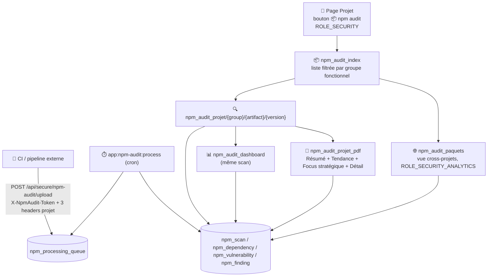

# 📦 Page npm audit

Vue de restitution des vulnérabilités de dépendances **npm** (JS/TS), sur le même principe que [Dependency-Check](../dependency-check/pages.md) pour les projets Maven (Java) : un scanner de **dépendances déclarées** (pas d'exécution de code, contrairement à [ZAP](zap.md)), dont le rapport est généré ailleurs (`npm audit --json`, côté CI) puis **poussé** vers Ma-Moulinette, qui se contente de l'ingérer et de l'afficher. C'est une page de **lecture pure** : aucun scan n'est déclenché depuis l'interface.

!!! note "🔒 Rôle dédié, même pipeline que Dependency-Check/ZAP"
    Toute la page (classe `NpmAuditPageController`) est protégée par `ROLE_SECURITY` — le même rôle que [Dependency-Check](../dependency-check/pages.md) et [ZAP](zap.md). Anti-IDOR par périmètre `groupe_fonctionnel`, même pattern que Dependency-Check (routes `{group}/{artifact}/{version}` directes, pas de token obfusqué comme ZAP/OWASP).

## 🔀 Ingestion : poussée par la CI, un seul upload

1. `POST /api/secure/npm-audit/upload` (+ `X-NpmAudit-Token`, `X-Project-Group`, `X-Project-Artifact`, `X-Project-Version`) : dépose le rapport en file d'attente (`npm_processing_queue`). Les 3 headers projet sont **obligatoires** — contrairement à Dependency-Check, qui lit son identité projet dans son propre rapport (`projectInfo`), `npm audit --json` n'en porte aucune.
2. `app:npm-audit:process` (worker cron) dépile, décompresse, parse et ingère : scans (`npm_scan`), paquets (`npm_dependency`, dédupliqués par nom), avis de sécurité (`npm_vulnerability`, dédupliqués par GHSA-ID), et les vulnérabilités constatées par paquet (`npm_finding`).
3. `GET /npm-audit` (liste des paquets scannés) puis `GET /npm-audit/projet/{group}/{artifact}/{version}` (détail d'un scan) et `GET /npm-audit/dashboard/{group}/{artifact}/{version}` (graphiques de ce scan).

### 📨 Un seul payload, jusqu'à trois rapports possibles (prod/dev, version installée)

`npm audit --json` seul ne dit pas, **par vulnérabilité**, si le paquet concerné est utilisé en production ou seulement en développement — seuls les totaux globaux (`metadata.dependencies`) distinguent prod/dev, pas chaque entrée de `vulnerabilities{}`. La seule méthode fiable est de croiser deux rapports : le rapport complet et un second rapport limité aux dépendances de production (`npm audit --omit=dev --json`).

De la même façon, `npm audit --json` ne restitue jamais la version **réellement installée** d'un paquet, seulement une plage de version vulnérable (`range`) — voir la section « Limites des données » ci-dessous. Pour l'avoir, la CI peut fournir un 3ᵉ rapport optionnel, `npm ls --all --json`, qui donne l'arbre résolu avec la version exacte de chaque paquet.

Plutôt que d'exiger plusieurs requêtes HTTP successives (risque d'ordre/désynchronisation), le corps de la requête **enveloppe les rapports bruts dans un seul upload** :

```json
{
  "full": { "...": "sortie brute de npm audit --json..." },
  "prodOnly": { "...": "sortie brute de npm audit --omit=dev --json... (optionnel)" },
  "installed": { "...": "sortie brute de npm ls --all --json... (optionnel)" }
}
```

`prodOnly` et `installed` sont tous les deux optionnels, indépendamment l'un de l'autre. Si `prodOnly` est absent, le champ *Origine* du tableau des vulnérabilités (page projet) reste **indéterminé** plutôt que de supposer silencieusement un paquet « dev ». Si `installed` est absent, la colonne « Plage vulnérable » n'affiche que la plage, sans ligne « Installée : » — voir la section « Limites des données » ci-dessous.

## 🦊 Côté CI (exemple GitLab)

```bash
npm audit --json > full.json
npm audit --omit=dev --json > prod-only.json
npm ls --all --json > installed.json

PAYLOAD=$(jq -n --slurpfile f full.json --slurpfile p prod-only.json --slurpfile i installed.json \
  '{full: $f[0], prodOnly: $p[0], installed: $i[0]}')

RESPONSE=$(curl -sS -w "\n%{http_code}" \
  -X POST \
  -H "Content-Type: application/json" \
  -H "X-NpmAudit-Token: $NPMAUDIT_INGEST_TOKEN" \
  -H "X-Project-Group: $PROJECT_GROUP" \
  -H "X-Project-Artifact: $PROJECT_ARTIFACT" \
  -H "X-Project-Version: $PROJECT_VERSION" \
  --data "$PAYLOAD" \
  "$MA_MOULINETTE_URL/api/secure/npm-audit/upload")
HTTP_CODE=$(echo "$RESPONSE" | tail -n1)
# 202 = nouveau, 200 = idempotence (déjà reçu), autre = erreur
[ "$HTTP_CODE" -eq "202" ] || [ "$HTTP_CODE" -eq "200" ] || exit 1
```

`$PROJECT_GROUP`/`$PROJECT_ARTIFACT`/`$PROJECT_VERSION` viennent typiquement de `sonar-project.properties` (`sonar.projectKey=group:artifact`) et de `package.json` (`version`) — mêmes sources que pour les autres indicateurs d'un projet JS/TS sans `pom.xml` (voir la page [ZAP](zap.md), section sur l'origine de ces valeurs selon le langage).

Format accepté : JSON brut (`application/json`) ou compressé (`application/gzip`/`application/x-gzip`, `application/zip`). Polling optionnel du statut : `GET /api/secure/npm-audit/status/{ulid}` (même token).

## 1️⃣ 🗺️ Cartographie

<!-- markdownlint-disable MD046 -->

<!-- markdownlint-enable MD046 -->

## 2️⃣ 🧭 Chemin de fer

<!-- markdownlint-disable MD046 -->
```text
Page npm audit — liste (/npm-audit)
│
├── 🧵 Fil d'Ariane : Accueil › Projet › npm audit
├── 🔔 Zone de messages (flash serveur uniquement)
├── 👻 Titre : npm audit — Paquets scannés
├── 🌐 Bouton « Vue cross-projets par paquet » (visible seulement si ROLE_SECURITY_ANALYTICS)
│
└── 🗒️ Tableau (ou callout « Aucun paquet n'a encore été scanné »)
         Projet / Version / CRITICAL / HIGH / MODERATE / LOW / Scan date / Détail

Page npm audit — vue cross-projets par paquet (/npm-audit/paquets, ROLE_SECURITY_ANALYTICS)
│
├── 🧵 Fil d'Ariane : Accueil › npm audit › Paquets
├── 👻 Titre : npm audit — Paquets (vue cross-projets)
│
├── 🔲 4 tuiles : Projets scannés / Paquets concernés / Avis cumulés / Paquets mutualisés (≥2 projets)
├── 📊 Top 10 paquets par nombre de projets touchés (bar horizontal) + ℹ️ info_callout
│
└── 🗒️ Tableau complet, trié par projets touchés décroissant
         Paquet / Projets touchés / Avis cumulés / Pire sévérité

Page npm audit — détail d'un scan (/npm-audit/projet/{group}/{artifact}/{version})
│
├── 🧵 Fil d'Ariane : Accueil › npm audit › {artifact} {version}
├── 👻 Titre : {artifact} ({group}) — {version}
├── 📊 Bouton « Dashboard » / 📄 Bouton « Rapport PDF »
│
├── 🔲 5 tuiles de synthèse : Scan du / Dépendances prod / Dépendances dev / Optional-Peer / Vulnérabilités (total)
├── 📊 Répartition par sévérité (5 badges CRITICAL/HIGH/MODERATE/LOW/INFO)
│
├── 📦 Paquets concernés (1 ligne par paquet ayant ≥1 avis réel) + ℹ️ info_callout (CVSS/CWE/GHSA + nuance 6 vs N paquets)
│        Paquet / Type / Origine / CVSS (pire) / CWE (nombre de catégories distinctes)
│
└── 🔎 Détail par avis de sécurité, groupés par sévérité (1 tableau par sévérité présente)
         Paquet / Direct-Transitif / Origine (Production/Dev/Indéterminé) / CVSS / Advisory (lien GHSA) / Plage vulnérable / Correctif / CWE / Titre
    (ou message « Aucune vulnérabilité détectée »)

Page npm audit — dashboard (/npm-audit/dashboard/{group}/{artifact}/{version})
│
├── 🧵 Fil d'Ariane : Accueil › npm audit › {artifact} {version} › Dashboard
├── 👻 Titre : Dashboard npm audit — {artifact} {version}
│
├── 📊 Répartition par sévérité (pie chart) + ℹ️ info_callout
├── 📊 Répartition par origine (Production/Dev/Indéterminé) x sévérité (bar empilé) + ℹ️ info_callout
├── 📊 Direct vs Transitif x sévérité (bar empilé) + ℹ️ info_callout
└── 📊 Top 10 paquets vulnérables de ce scan (bar horizontal) + ℹ️ info_callout

Rapport PDF (/npm-audit/projet/{group}/{artifact}/{version}/pdf) — voir section 8️⃣ pour le détail

🔘 Footer (sur toutes les pages web)
```
<!-- markdownlint-enable MD046 -->

## 3️⃣ 📋 Contenu de la page détail

- **Tuiles de synthèse** (titre/trait/valeur, même présentation que la modale « Information » de [Suivi](suivi.md)) : date du scan, répartition des dépendances **prod/dev/optional/peer** (`metadata.dependencies` — sans équivalent côté Dependency-Check, qui n'a pas cette notion pour un `.jar` Maven), total de vulnérabilités ;
- **Répartition par sévérité** : 5 badges `CRITICAL`/`HIGH`/`MODERATE`/`LOW`/`INFO` — npm utilise **`moderate`**, pas `medium` comme Dependency-Check (terminologie npm native conservée, pas forcée dans le vocabulaire DC) ;
- **Paquets concernés** : 1 ligne par paquet distinct ayant **au moins un avis de sécurité réel** (pas le total `metadata.vulnerabilities` de npm audit — voir la nuance en section 5️⃣) — Paquet / Type (Direct/Transitif) / Origine / CVSS (le plus élevé parmi les avis de ce paquet) / CWE (nombre de catégories distinctes cumulées, pas les codes eux-mêmes). Note d'information expliquant CVSS/CWE/GHSA juste à côté ;
- **Détail par avis de sécurité**, groupé par sévérité, une ligne par (paquet, avis de sécurité) :
  - **Direct/Transitif** : dépendance directe de `package.json`, ou introduite par une autre dépendance ;
  - **Origine** : `Production`/`Dev` si le payload contenait un rapport `prodOnly`, `Indéterminé` sinon — voir la limite dédiée ci-dessous ;
  - **Advisory** : identifiant [GHSA](https://github.com/advisories) (lien direct quand l'URL est connue) ;
  - **Plage vulnérable** : la plage de version constatée dans le rapport — voir la limite ci-dessous, ce n'est **pas** la version installée exacte. Une ligne « Installée : » apparaît juste en dessous **si** le payload contenait un rapport `installed` et que ce paquet y a été trouvé ;
  - **Correctif** : disponible ou non (`npm audit fix`), avec la version cible et un repère « changement majeur » si la mise à jour casse la compatibilité SemVer.

## 4️⃣ 📊 Contenu de la page dashboard

Quatre graphiques, tous centrés sur le scan courant (pas de vue cross-projets) :

- **Répartition par sévérité** (pie chart) — identique au tableau de la page détail, en graphique.
- **Vulnérabilités par origine** (bar empilé par sévérité trois catégories : Production/Dev/Indéterminé) — reprend la colonne *Origine* du tableau, agrégée. **Limite assumée** : ne distingue que production/non-production (`is_prod`), **pas** *optional*/*peer* séparément pour une vulnérabilité donnée — `npm audit --omit=dev` ne permet pas cette granularité. La ventilation complète prod/dev/optional/peer existe uniquement au niveau du **décompte global des dépendances** (tuiles de la page détail), pas par vulnérabilité trouvée — ce n'est donc pas, contrairement à l'intention initiale du plan, un même découpage à quatre catégories ici.
- **Direct vs Transitif** (bar empilé par sévérité, 2 catégories) — reprend la colonne *Type* du tableau, agrégée.
- **Top 10 paquets vulnérables** (bar horizontal) — paquets de **ce scan** avec le plus de findings
  (toutes sévérités confondues), par opposition à un classement multi-projets.

## 5️⃣ ⚠️ Limites des données connues et assumées

npm audit --json ne restitue pas tout ce que Dependency-Check sait donner pour un `.jar` Maven — ces limites viennent de la source, pas du pipeline d'ingestion :

- **Pas de version installée exacte dans le rapport `npm audit` lui-même** : seulement une plage de version vulnérable (`range`). `npm audit` résout bien une version exacte en interne (via `package-lock.json`), mais ne la restitue jamais dans sa sortie JSON. **Si la CI fournit en plus le rapport optionnel `installed` (`npm ls --all --json`)**, la version réellement installée est affichée sous la plage ; sinon, seule la plage est affichée, sans inventer une fausse précision. Si l'arbre `installed` contient plusieurs versions distinctes du même paquet (conflit de résolution npm, plusieurs copies à des profondeurs différentes), elles sont toutes affichées, séparées par une virgule — plutôt que d'en choisir une arbitrairement.
- **Pas d'identité projet dans le rapport** (pas de `projectInfo` comme Dependency-Check) : d'où les 3 headers HTTP obligatoires à l'upload.
- **`isProd` indéterminé si `prodOnly` absent** : tant que la CI n'envoie que le rapport complet, aucune vulnérabilité n'est marquée « prod » ou « dev » avec certitude — préférable à une estimation silencieusement fausse.
- **Le total `metadata.vulnerabilities` de npm audit compte des *paquets*, pas des avis de sécurité** : ce décompte (affiché tel quel dans les tuiles/badges de la page) classe chaque paquet par sa **pire** sévérité, pas le nombre d'avis GHSA réels — un paquet avec 6 avis distincts (ex. `undici` sur un vrai projet testé) compte pour **1** dans ce total, pas 6. Pire : npm audit peut aussi y inclure un paquet qui n'a **aucun avis qui lui soit propre**, simplement parce qu'il dépend d'un paquet vulnérable (`via` contient uniquement une chaîne, ex. `@angular/build` dépendant de `vite`) — ce paquet apparaît dans les statistiques globales de npm mais jamais dans le tableau « Paquets concernés » ni dans le détail par avis, puisqu'aucun `NpmFinding` n'est créé pour lui. Confirmé sur un vrai rapport (projet Angular de démo) : npm annonce 6 paquets, dont 5 seulement ont un avis réel, pour un total de 20 avis de sécurité distincts.

## 6️⃣ ⚠️ Messages remontés par la page

| Sévérité | Déclencheur | Message |
| --- | --- | --- |
| `info` | Aucun périmètre `groupe_fonctionnel` valide | ℹ️ Aucun projet accessible dans votre périmètre groupe_fonctionnel. |
| `warning` | Aucun scan npm audit pour ce triplet (projet/version) | ⚠️ Aucun scan npm audit trouvé pour {group}:{artifact}:{version}. Vérifier que la CI a bien envoyé un rapport. |
| `error` | Échec de lecture des vulnérabilités (erreur base de données) | ❌ La récupération des vulnérabilités a échoué (Erreur {code}). |
| — (403, pas de flash) | Projet hors périmètre `groupe_fonctionnel` (IDOR) | ⚠️ Page d'erreur 403 standard |

## 7️⃣ 🔗 Point d'entrée

Bouton **📦 npm audit** sur la page [Projet](projet.md), visible si `ROLE_SECURITY` — ouvre la liste `/npm-audit` (même comportement que le bouton Dependency-Check).

## 8️⃣ 📄 Rapport PDF

Bouton **📄 Rapport PDF** sur la page détail d'un scan (`GET /npm-audit/projet/{group}/{artifact}/{version}/pdf`), suit le même mécanisme de fusion FPDI (orientations mixtes) que le rapport Dependency-Check. 2 sous-PDF Dompdf fusionnés — portrait puis paysage, jamais de retour en portrait après (contrairement à Dependency-Check, dont le détail paysage est suivi d'une 3ᵉ partie portrait) :

- **Portrait** — trois sections séparées par un saut de page, dans l'ordre des priorités de lecture plutôt que l'ordre des pages web :
    1. **Résumé** : identification, paquets concernés par origine (Production/Dev/Indéterminé — et non le total brut `metadata.vulnerabilities` de npm audit, voir section 5️⃣), répartition par sévérité.
    2. **Tendance** (nouveau, sans équivalent sur la page web) : évolution du nombre de vulnérabilités sur les dix derniers scans de ce **projet** (`group:artifact`, toutes versions confondues — npm n'a pas de socle de version stable), histogramme + tableau avec une colonne **Évolution** (delta coloré vs le scan précédent : ▲ rouge = dégradation, ▼ vert = rémédiation, `=0` = stable). Nécessite au moins deux scans pour ce projet, sinon un message l'indique.
    3. **Focus stratégique** : tableaux croisés sévérité × origine et sévérité × direct/transitif (mêmes agrégats que le dashboard, `countByOriginAndSeverity()`/`countByDirectAndSeverity()`), top 10 paquets vulnérables avec une barre de poids relative.
- **Paysage, en dernier** — détail complet par avis de sécurité (comme la page web), généré seulement s'il y a des findings. Volontairement en dernier : ce qui compte le plus est la synthèse.

Mêmes options de requête que les autres rapports PDF du projet : `?type=...` (mention bas de page/filigrane) et `?watermark=on|off` (prime sur le mode configuré).

## 9️⃣ 🌐 Vue cross-projets par paquet

`GET /npm-audit/paquets`, gardée par **`ROLE_SECURITY_ANALYTICS`** en plus de `ROLE_SECURITY` (classe) — volontairement globale, **sans anti-IDOR par périmètre** `groupe_fonctionnel` : c'est une vue organisation entière pour le pilotage sécurité, non une page "par projet". Différente du "dashboard cross-projets" du plan initial (voir section 🔟) : il n'y a pas de graphiques par scan multi-projets, juste un agrégat simple par paquet.

- **4 tuiles de synthèse** : projets scannés, paquets concernés, avis cumulés, paquets « mutualisés » (touchant ≥2 projets — ceux à corriger en priorité à l'échelle du parc).
- **Graphique** : top 10 des paquets par **nombre de projets touchés** (pas par nombre d'avis — un paquet partagé par beaucoup de projets est prioritaire même avec un seul avis chacun).
- **Tableau complet** : Paquet / Projets touchés / Avis cumulés / Pire sévérité, trié par nombre de projets touchés décroissant.
- **Calcul** : agrégation sur le **dernier scan de chaque projet uniquement** (pas tout l'historique) — sinon un projet rescanné plusieurs fois compterait plusieurs fois pour le même paquet, faussant le classement.
- **Point d'entrée** : bouton « 🌐 Vue cross-projets par paquet » sur la page liste `/npm-audit`, visible uniquement avec `ROLE_SECURITY_ANALYTICS`.

## 🔟 🚧 Hors périmètre

- **Dashboard cross-projets par scan** (graphiques multi-projets, et non plus l'agrégat simple de la section 9️⃣ ci-dessus) : les versions de `package.json` évoluent librement par projet (il n'y a pas de socle commun comme pour un `.jar` Maven), une vue agrégée de ce type serait trop lourde à maintenir et peu fiable.
- **Page index enrichie** (filtre, tri) : non tranché pour l'instant.
- **Purge de la file** : `app:npm-audit:purge` planifiée au cron Supercronic (`docker/etc/cron/ma-moulinette`) depuis le 21/11/2026, quotidien à 3h15, rétention 30 jours — voir [commandes Prod](../../commandes/prod.md).

## 🔟+1️⃣ 📚 Pour aller plus loin

- [Projet](projet.md) — point d'entrée vers npm audit.
- [Dependency-Check](../dependency-check/pages.md) — même principe d'ingestion, pour les dépendances Maven (Java).
- [ZAP (DAST)](zap.md) — autre scanner de sécurité poussé par la CI, principe d'upload par enveloppe JSON comparable.
- [Gestion de la sécurité](../developpement/securite.md) — détail des rôles.

-**-- FIN --**-

[Retour au menu principal](/index.html)
