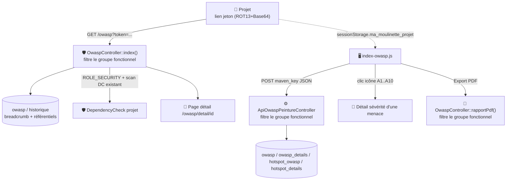

# 🛡️ Page OWASP

Vue de restitution des vulnérabilités et hotspots de sécurité d'un projet, classés selon les référentiels **OWASP Top 10 2017 et 2021** (le référentiel 2025 est prévu côté interface mais pas encore supporté par SonarQube — voir la note ci-dessous). C'est une page de **lecture pure** : elle ne déclenche aucune collecte SonarQube — les données proviennent de la collecte lancée depuis la page [Projet](projet.md) (`ApiCollecteController` → tables `owasp`/`owasp_details`/`hotspot_owasp`/`hotspot_details`).

!!! note "🔓 Aucun rôle métier dédié, mais un filtrage par groupe fonctionnel"
    Contrairement à ce qu'on pourrait attendre, l'accès à la page OWASP elle-même n'exige aucun rôle spécifique (`ROLE_UTILISATEUR` suffit). Seul le bouton **Dependency-Check** est conditionné par `ROLE_SECURITY`.
    Depuis le 2026-07-17, l'accès au projet lui-même est filtré par **groupe fonctionnel** de l'utilisateur authentifié (voir ci-dessous) — aligné sur [Suivi](suivi.md) et [COSUI](cosui.md).

## 🔀 Deux mécanismes de clé Maven, deux filtrages

OWASP est la seule des pages « projet » à combiner **deux** sources de clé Maven distinctes, chacune désormais filtrée séparément :

1. **Le chargement de la page** (`GET /owasp?token=...`) : comme [Suivi](suivi.md)/[COSUI](cosui.md), un jeton ROT13+Base64 (`salt|maven_key`) est décodé côté serveur par `OwaspController::index()`. Il sert au fil d'Ariane, au bloc « Informations » (application/version) et au lien Dependency-Check.
2. **Les appels AJAX de la page** (`remplissageOwaspInfo`, `remplissageHotspotInfo`, `remplissageHotspotListe`, `remplissageOwaspDetails`, `remplissageHotspotDetails`, `remplissageDetailsHotspotOwasp`, l'export PDF) : `index-owasp.js` ne réutilise **pas** le token — il relit `sessionStorage.getItem('ma_moulinette_projet')` (posé par la page [Projet](projet.md) au clic sur un projet) et l'envoie tel quel en POST à `ApiOwaspPeintureController`.

!!! note "✅ Filtrage par groupe fonctionnel ajouté sur les deux mécanismes"
    Jusqu'ici, ni `OwaspController::index()`/`rapportPdf()`, ni les 5 endpoints de `ApiOwaspPeintureController` ne vérifiaient l'appartenance du projet au groupe fonctionnel de l'utilisateur — seul le pare-feu (`ROLE_UTILISATEUR`) protégeait la page. Comme `sessionStorage` est manipulable côté client (outils de développement du navigateur), le filtrage ne pouvait de toute façon pas reposer sur le JS : il fallait le poser côté serveur, sur chacun des 7 points d'entrée (`index`, `rapportPdf`, et les 5 méthodes de `ApiOwaspPeintureController`).
    La vérification (`ProjetPerimetreGuard::verifierPerimetreProjet()`) est désormais **mutualisée dans un trait partagé** (`App\Controller\Traits\ProjetPerimetreGuard`) plutôt que dupliquée méthode par méthode — c'est la 3ᵉ/4ᵉ reprise du même contrôle après Suivi/COSUI, ce qui a fait basculer la duplication en abstraction.

!!! note "✅ Casse de la clé Maven préservée"
    `OwaspController::decodeToken()` appliquait un `strtolower()` sur la clé Maven décodée — absent de `SuiviController`/`CosuiController`. Une clé à casse mixte réelle (ex. `fr.ma-moulinette:Ma-Moulinette`) devenait `ma-moulinette` et ne correspondait plus (comparaison stricte `===`) à l'entrée `liste_projet`/`historique` : le projet était rejeté à tort en 406 alors qu'il appartenait bien au périmètre de l'utilisateur. Corrigé pour préserver la casse, comme le reste de l'application.

## 🗺️ Cartographie

<!-- markdownlint-disable MD046 -->

<!-- markdownlint-enable MD046 -->

## 📅 Référentiel actif selon la version SonarQube

Le référentiel proposé dépend du paramètre applicatif `sonar.version` (`SONAR_VERSION`), pas d'un choix utilisateur libre :

| Version SonarQube | Référentiels disponibles |
| --- | --- |
| 8 | 2017 uniquement |
| ≥ 9 (y compris les versions calendaires type `2024`, `2026`, ...) | 2017 + 2021 |

!!! note "🤔 Contre-intuitif : le référentiel OWASP et son support SonarQube n'avancent pas au même rythme"
    L'OWASP publie ses Top 10 par génération — **2013, 2017, 2021, 2025**. Mais **l'intégration côté SonarQube** (les facettes `owaspTop10`/`owaspTop10-2021`/... exposées par `/api/issues/search`) ne suit pas cette date de publication : c'est SonarQube qui décide, dans une version donnée de son propre produit, quels référentiels il sait classer.
    À ce jour, **même la dernière version connue de SonarQube (2026) ne classe pas encore les failles selon l'OWASP Top 10 2025** — seuls 2017 et 2021 sont réellement disponibles, quelle que soit la valeur de `sonar.version`.
    Concrètement : le bouton « OWASP 2025 » de la page reste désactivé indépendamment de `sonar.version`, tant qu'aucune version de SonarQube ne supporte la facette correspondante — pas de seuil numérique à deviner ou à maintenir pour ça.
    Le jour où SonarQube l'ajoutera, il faudra explicitement l'activer dans `templates/owasp/index.html.twig` (et implémenter la collecte associée dans `BatchCollecteOwaspController`, qui aujourd'hui ne récupère que 2017 et 2021).

!!! note "🔍 Page à 0 partout malgré des vraies failles visibles dans SonarQube : vérifier la classification côté SonarQube avant de suspecter l'application"
    `BatchCollecteOwaspController` ne s'appuie plus sur les facettes officielles `owaspTop10`/`owaspTop10-2021` de SonarQube (voir note suivante). Il reste vrai qu'une règle peut être détectée comme un problème de sécurité générique (`sonarsourceSecurity` non vide côté SonarQube) sans être classée OWASP du tout, dans ses métadonnées comme dans son tag — dans ce cas la page affiche 0 en toute cohérence, ce n'est pas un bug applicatif.

!!! bug "🔴 Cause racine trouvée le 27/10/2026 — la facette officielle SonarQube n'indexe jamais FindSecBugs"
    Vérifié en direct sur une instance SonarQube 26.10 réelle, en comparant les métadonnées serveur des deux familles de règles (`/api/rules/show`) :

    - Les règles **SonarSource** (repo `java`, ex. `S2068`) portent un bloc structuré `securityStandards.OWASP`/`OWASP Top 10 2021` dans leur JSON de métadonnées — c'est ce bloc, et uniquement lui, qui alimente la facette officielle `owaspTop10`/`owaspTop10-2021`.
    - Les règles du plugin tiers **FindSecBugs** (repo `findsecbugs`, ex. `SQL_INJECTION_JPA`) n'ont **jamais** ce bloc — seulement un tag texte libre `owasp-aX` (`sysTags`), hérité de la classification OWASP **2013**, jamais migré vers 2021. Ce tag n'est jamais lu par la facette officielle.
    - Conséquence mesurée sur un vrai projet : 453 vulnérabilités d'injection SQL (`findsecbugs:SQL_INJECTION_JPA`, tag `owasp-a1`) — 0 d'entre elles visibles via `facets=owaspTop10`, qui n'en comptait que 5 (une seule règle core, `S4512`, sur la même catégorie).

    Le mécanisme de secours par tag qui existait avant cette date comblait les compteurs globaux mais ne récupérait jamais le détail par sévérité d'une catégorie classée uniquement par FindSecBugs — tableau de détail vide côté page malgré un total non nul. Remplacé par le mécanisme ci-dessous.

!!! note "✅ Classification locale par liste de règles (remplace la facette + le secours par tag)"
    `BatchCollecteOwaspController` fait désormais **un seul appel HTTP**, paginé, `GET /api/issues/search?rules=<~126 clés>` — la liste complète des règles couvrant OWASP (65 règles SonarSource + 61 règles FindSecBugs, cf. `OwaspRuleClassifierService::allRuleKeys()`), filtré par statut comme toute autre collecte. Chaque issue reçue (règle, composant, ligne, sévérité) est ensuite classée **localement**, en PHP, par `OwaspRuleClassifierService::classify()`, à partir d'une table de correspondance règle→catégorie construite une fois depuis les métadonnées officielles du plugin Java (2017 **et** 2021) et les tags FindSecBugs (2017 **uniquement**, jamais 2021).
    Les compteurs par catégorie (`owasp.categories`, colonne JSON) portent chacun leur propre `source` : `core` (règle SonarSource), `findsecbugs` (règle FindSecBugs), ou `mixed` (les deux contribuent à la même catégorie) — plus précis que l'ancienne colonne `owasp.source`, qui ne portait qu'une seule valeur pour toute la ligne.
    Les **Security Hotspots** ne sont pas concernés par ce changement (`BatchCollecteHotspotOwaspController`, inchangé) : ce sont quasi exclusivement des règles SonarSource, déjà correctement classées par leur propre facette.

!!! bug "🔴 Bug corrigé le 26/10/2026 — modale « Détail » d'une catégorie (sévérité hotspot)"
    `HotspotOwaspRepository::countHotspotOwaspMenaceByStatus()` (utilisée par la modale ouverte via l'icône 🔎 d'une ligne du tableau de synthèse) ne filtrait pas par `referential_owasp` — alors que `hotspot_owasp` porte une ligne distincte par (maven_key, menace, referential_owasp) pour 2017 **et** 2021. Les compteurs Élevée/Moyenne/Faible de la modale sommaient donc silencieusement les deux référentiels, affichant le même résultat quel que soit l'onglet 2017/2021 sélectionné. `referential_owasp` est désormais transmis de bout en bout (JS → `peintureOwaspSeverity()` → repository).

    Deux autres défauts corrigés sur cette même modale :

    - **Contenu non à jour au changement de catégorie** : le clic sur l'icône 🔎 ouvrait la modale **avant** la fin de l'appel AJAX de remplissage (fonction asynchrone non attendue) — elle affichait un instant le contenu de la catégorie précédemment consultée, avant de se mettre à jour. Le clic attend désormais la fin du chargement avant d'ouvrir la modale.
    - **Aucune donnée de vulnérabilité** : la modale n'a toujours affiché que la sévérité des **hotspots** (Élevée/Moyenne/Faible), jamais celle des **vulnérabilités** (Bloquant/Critique/Majeur/Mineur) — alors que la colonne « Faille » de la même ligne du tableau peut être non nulle. Une nouvelle section « Vulnérabilités » a été ajoutée dans la modale, réutilisant les données déjà renvoyées par `/api/secure/peinture/owasp/liste` à chaque changement de référentiel (pas de nouvel appel réseau).

## 🗒️ Détail des vulnérabilités OWASP (page + export PDF)

Jusqu'au 28/10/2026, le seul tableau de détail ligne à ligne de la page (et du PDF) ne couvrait que les **Security Hotspots** — les vulnérabilités OWASP elles-mêmes n'avaient qu'un compteur par catégorie (tableau de synthèse A1-A10 + modale de détail par sévérité), jamais la liste des issues individuelles (règle, fichier, ligne, message).

Nouvelle table **`owasp_details`** (snapshot, réécrite en entier à chaque collecte comme `owasp` — une ligne par `(maven_key, referential_owasp, issue)`, donc une même issue classée sur les 2 référentiels donne 2 lignes distinctes, chacune avec ses propres catégories pour ce référentiel). Alimentée dans la collecte OWASP existante, sans appel SonarQube supplémentaire : `BatchCollecteOwaspController::fetchAllOwaspIssues()` récupérait déjà `line`/`message` dans la réponse paginée `/api/issues/search` utilisée pour le tableau de synthèse, simplement sans les capturer jusqu'ici ; `OwaspRuleClassifierService::classify()` construit désormais, dans la même boucle, un tableau `details` (une entrée par issue classée) en plus des compteurs agrégés.

**Page web** : nouveau tableau « Détail des vulnérabilités OWASP », positionné **avant** le tableau des Hotspots (cohérent avec la priorité « vulnérabilités d'abord » déjà appliquée ailleurs sur la page) — les **10 vulnérabilités les plus critiques** (triées Bloquant > Critique > Majeur > Mineur), avec le nombre total réel affiché en dessous (« Affichage des 10 … sur N au total »). Alimenté par le nouvel endpoint `POST /api/secure/peinture/owasp/details` (`ApiOwaspPeintureController::peintureOwaspDetails()`), même garde de périmètre que les 5 endpoints existants.

**Export PDF** : nouvelle page dédiée « Liste détaillée des vulnérabilités OWASP » (même structure de tableau que la page web), insérée **avant** la page Hotspot existante. Toutes les issues classées sont persistées en base (pas seulement les 10 affichées) — le tri par criticité et la limite à 10 se font à la lecture (`OwaspDetailsRepository::selectOwaspDetailsTop10BySeverity()`), le total réel vient d'un comptage séparé (`countOwaspDetails()`), jamais limité à 10.

!!! bug "🔴 Bug corrigé le 28/10/2026 — collecte en échec sur un message SonarQube long"
    `owasp_details.message`/`file_path` sont des `VARCHAR(255)`, mais le message brut d'une issue SonarQube (notamment certaines règles FindSecBugs) n'est pas garanti de tenir dans cette limite — une collecte réelle sur un projet avec un message plus long faisait échouer tout l'`INSERT` (transaction annulée, « valeur trop longue pour le type character varying(255) »), la collecte OWASP entière repartait en erreur. `message` et `file_path` sont désormais tronqués à 255 caractères (`mb_substr`, respect des limites UTF-8) avant l'insertion, dans `BatchCollecteOwaspController`.

!!! bug "🔴 Bug corrigé le 28/10/2026 — répartition par module incohérente avec le référentiel affiché"
    Trouvé en comparant le PDF du référentiel 2021 (83 vulnérabilités) à sa propre « Répartition par module » (Frontend/Backend/Autre), qui totalisait 541 — le total du référentiel **2017**, pas celui de 2021. Cause : `OwaspRuleClassifierService::classify()` comptait la répartition module **une seule fois, globalement** (toute issue classée sur au moins un référentiel), puis cette même valeur globale était stockée identique sur la ligne `owasp` de 2017 **et** sur celle de 2021 (`BatchCollecteOwaspController::$buildRow`, qui lisait le même compteur pour les deux lignes). Ce défaut touchait **la page web et le PDF**, les deux lisant la même colonne. `classify()` compte désormais la répartition séparément par référentiel — seules les issues qui matchent un référentiel donné contribuent à sa propre répartition.

!!! bug "🔴 Bug corrigé le 28/10/2026 — en-tête de colonne « Composant » mal stylé dans le PDF"
    La règle CSS `.col-component` du PDF (police à chasse fixe réduite, pensée pour les chemins de fichier des cellules) ciblait aussi bien les `<td>` que le `<th>` d'en-tête — la même classe étant posée sur les deux, l'en-tête « Composant »/« Component » s'affichait dans cette police minuscule au lieu du style d'en-tête normal (gras, taille standard). Restreint aux `<td>` uniquement, sur les deux tableaux de détail (vulnérabilités, hotspots).

## 🧭 Chemin de fer de la page

<!-- markdownlint-disable MD046 -->
```text
Page OWASP
│
├── 🧵 Fil d'Ariane : Accueil › Projet › OWASP
├── 🔔 Zone de messages (flash serveur + messages JS)
│
├── 🔘 Sélecteurs de référentiel (2017 / 2021 / 2025 — actif/désactivé selon sonar.version, référentiel par défaut déjà actif et affiché sans clic)
├── 📄 Bouton Export PDF (maven_key + référentiel lus depuis sessionStorage)
├── 📦 Bouton Dependency-Check (ROLE_SECURITY + scan DC existant, découplé du breadcrumb OWASP)
│
├── ℹ️ Callout « nombre de règles » (SonarQube + FindSecBugs couvrant le référentiel actif)
│
├── 🛡️ Tuile compteur Vulnérabilités OWASP (total + note A-E — badge .stat-note)
├── 🔥 Tuile compteur Hotspot (total + note A-E, taux de validation — badge .stat-note)
│
├── 🛡️ Tuile détail Vulnérabilités OWASP (bloquante/critique/majeure/mineure)
├── 🔥 Tuile détail Hotspot (HIGH/MEDIUM/LOW, examiné/à vérifier)
│
├── 📦 Répartition par module (frontend/backend/autre — basée sur les vulnérabilités OWASP)
│
├── 📊 Tableau de synthèse (une ligne par catégorie A1..A10)
│        ├── icône 🔎 → modale détail (sévérité des vulnérabilités ET des hotspots de la catégorie)
│        ├── colonne Faille (compteur)
│        └── colonne Hotspot (compteur + % examiné)
│
├── 🛡️ Détail des vulnérabilités OWASP (10 plus critiques, triées par sévérité + total réel en dessous)
│
├── 🔥 Liste des Hotspots — menaces potentielles (règle, sévérité, composant, ligne, message, statut)
│
├── 📊 Graphique en barres (répartition des menaces par catégorie A1..A10)
│
├── 📋 Comparaison des référentiels (bouton → modale image statique 2017/2021 vs 2025)
│
├── 📘 Accordéon Référentiel (sélecteur + 3 blocs 2017/2021/2025, 10 catégories chacun)
│        └── « Plus de détails... » → /owasp/detail/{id}
│
└── 🪟 Modale « Owasp et points chauds » (détail d'une catégorie : sévérité des vulnérabilités Bloquant/Critique/Majeur/Mineur + sévérité des hotspots Élevée/Moyenne/Faible)
```
<!-- markdownlint-enable MD046 -->

## 📋 Contenu de la page

- **Callout « nombre de règles »** : encart pédagogique indiquant, pour le référentiel actif, le nombre de règles (SonarQube elles-mêmes + plugin tiers FindSecBugs) sur lesquelles repose la classification locale — toujours visible, en tête de page, mis à jour à chaque changement de référentiel ;
- **Tuiles compteur** (résultat en premier) : total + note A-E pour Vulnérabilités OWASP et pour Hotspot, badge `.stat-note`/`note-vertX` — même convention visuelle que les tuiles Accessibilité/RCI/Empreinte Écologique de la page [Projet](projet.md). La note Vulnérabilités OWASP retient la pire sévérité présente sur l'ensemble des catégories (Bloquant > Critique > Majeur > Mineur, A si aucune vulnérabilité) ; la note Hotspot reste le taux de validation déjà existant ;
- **Tuiles détail** (juste en dessous) : répartition par sévérité — Bloquante/Critique/Majeure/Mineure pour les vulnérabilités, HIGH/MEDIUM/LOW/Examiné/À vérifier pour les hotspots ;
- **Répartition par module** (frontend/backend/autre — voir [Architecture des applications Java](../architecture/architecture-java.md)) : porte désormais sur les **vulnérabilités OWASP**, pas sur les hotspots — remplace la répartition affichée jusqu'ici ;
- **Tableau de synthèse** : une ligne par catégorie A1-A10, nombre de failles et de hotspots avec badge de note (`.badge`/`note-a..e`, inchangé pour ce tableau) ; la source (core/FindSecBugs/mixte) du référentiel actif est affichée juste au-dessus, à côté de son numéro ;
- **Détail des vulnérabilités OWASP** (nouveau le 28/10/2026, voir section dédiée ci-dessus) : les 10 vulnérabilités les plus critiques du référentiel actif, triées par sévérité, avec le nombre total réel en dessous ;
- **Liste des Hotspots** : règle, sévérité, composant, ligne, message, statut — couvre uniquement les Security Hotspots, jamais les vulnérabilités OWASP (titre renommé le 27/10/2026 pour clarifier cette portée, auparavant « Liste des failles de sécurité ») ;
- **Graphique en barres** : répartition des failles par catégorie ;
- **Sélecteur de référentiel** (2017/2021/2025) : accordéon listant chaque catégorie avec description et lien vers sa page de détail complète (contenu documentaire OWASP officiel).

!!! note "✅ Accordéon masqué par défaut au chargement"
    Les 3 blocs de l'accordéon démarraient tous avec `display-off` — rien n'était visible tant qu'on n'avait pas interagi une première fois, ce qui donnait l'impression qu'un premier clic « ne faisait rien ».
    Le bloc du référentiel actif le plus récent (2025 > 2021 > 2017, calculé côté Twig à partir des mêmes variables `referential_2017`/`referential_2021`/`referential_2025`) est désormais visible dès le chargement — sans appel SonarQube, c'est de la documentation déjà chargée par le contrôleur.
    Le `<select id="js-owasp-select">` est synchronisé sur ce même choix par défaut (attribut `selected` posé côté Twig) — auparavant il affichait toujours « OWASP 2017 » présélectionné, même quand l'accordéon montrait 2021 ou 2025.

!!! note "✅ Données du référentiel par défaut affichées sans clic préalable"
    Jusqu'ici, aucune donnée (tuiles, tableau de synthèse, graphique, répartition par module) ne s'affichait tant qu'on n'avait pas cliqué sur un des 3 boutons de référentiel, même si le référentiel par défaut était déjà visuellement actif ailleurs sur la page (accordéon, `<select>`). Le bouton correspondant au référentiel par défaut (2021 si disponible, sinon 2017) est désormais marqué actif dès le rendu côté Twig, et `index-owasp.js` charge ses données automatiquement à l'initialisation, sans attendre d'interaction. Les 3 boutons restent utilisables pour changer de référentiel ensuite.

## 📄 Export PDF

Génère un rapport PDF côté serveur à partir des mêmes données (aucun appel SonarQube au moment de l'export). Le bouton lit `maven_key` et le référentiel courant depuis `sessionStorage` (mêmes clés que les appels AJAX de la page).

Pages du rapport, dans l'ordre : informations projet + synthèse (vulnérabilités/hotspots/répartition par module) → catégories A1-A10 + graphique → **détail des vulnérabilités OWASP** (10 plus critiques, triées par sévérité + total réel) → **détail des Hotspots**. Les deux pages de détail sont désormais clairement séparées et correctement titrées (voir « Détail des vulnérabilités OWASP » ci-dessus) — avant le 28/10/2026, la seule page de détail du PDF portait le même titre trompeur que la page web (« Liste détaillée des vulnérabilités » alimentée en réalité par les Hotspots).

!!! caution "⚠️ Le référentiel 2025 n'est pas supporté par l'export PDF"
    La validation du paramètre `referential_owasp` de l'export accepte uniquement `2017` et `2021` (repli silencieux sur 2021 si `2025` est demandé). Sans conséquence aujourd'hui puisque le bouton 2025 est désactivé côté page (SonarQube ne le supporte pas encore), mais à corriger le jour où 2025 sera réellement activé pour ne pas réintroduire ce repli silencieux.

## 🔗 Dependency-Check

Le bouton vers [DependencyCheck](../dependency-check/pages.md) est **indépendant** de l'état des référentiels OWASP : il s'affiche dès qu'un scan DependencyCheck existe pour le projet (peu importe que les référentiels OWASP soient vides), sous réserve du rôle `ROLE_SECURITY`.

## 🔗 ZAP (DAST)

Un second bouton, 👻 **ZAP (DAST)**, suit le même principe que le bouton Dependency-Check : affiché dès qu'un scan ZAP existe pour le projet, sous réserve du rôle `ROLE_SECURITY`, et **repasse le token déjà décodé** (pas de nouvel encodage côté client) vers [la page ZAP](zap.md). Contrairement à Dependency-Check (analyse statique de dépendances), ZAP est un scanner **dynamique** (DAST) — complémentaire, pas redondant, avec l'analyse SAST de cette page.

## ⚠️ Messages remontés par la page

### Messages JS (`index-owasp.js` → `showMessage()`)

| Sévérité | Déclencheur | Message |
| --- | --- | --- |
| `error` | `peinture/owasp/liste` renvoie `code=400` | ❌ La requête n'est pas conforme (Erreur 400). |
| `warning` | `peinture/owasp/liste` renvoie `code=406` | ⚠️ Le projet n'a pas été trouvé ! |
| `error` | `peinture/owasp/hotspot/info`, `/hotspot/liste` ou `/hotspot/details` renvoie `code=400` | ❌ La requête n'est pas conforme (Erreur 400). |
| `error` | `peinture/owasp/hotspot/severity` renvoie `code=400` | ❌ [Severity] La requête n'est pas conforme (Erreur 400) ! |
| `warning` | Export PDF cliqué sans projet en `sessionStorage` | ⚠️ Aucun projet sélectionné — impossible d'exporter le rapport. |

### Flash serveur (`OwaspController`)

| Sévérité | Déclencheur | Message |
| --- | --- | --- |
| `error` | Paramètre `token` absent de l'URL | ❌ La requête est incorrecte (Erreur 400). |
| `error` | Décodage du token en échec (base64/format invalide) | ❌ La requête est incorrecte (Erreur 400). |
| `warning` | Utilisateur sans groupe fonctionnel (`ProjetPerimetreGuard`) | Vous devez être rattaché à un groupe fonctionnel (Erreur 404). |
| `warning` | Aucun projet dans le groupe fonctionnel filtré, ou clé Maven absente de la liste (`ProjetPerimetreGuard`) | Je n'ai pas trouvé de projets pour ton groupe fonctionnel. Vérifie le nom du tag utilisé dans SonarQube (Erreur 406). / Le projet n'est pas présent dans la liste de projets de l'utilisateur. |
| `error` | Échec de lecture d'un des 3 référentiels (`selectOwaspTop10Referential`) | Message dynamique du repository, préfixé ❌ |
| `warning` | Référentiels 2017, 2021 **et** 2025 tous vides | ⚠️ Les informations concernant les référentiels OWASP n'ont pas été trouvés. |
| `error` | Échec de `selectOwaspVersion` (breadcrumb) | Message dynamique incluant le code d'erreur |

`OwaspController::rapportPdf()` (export PDF) lève une `NotFoundHttpException` (404 HTTP direct, pas de flash) en cas de clé Maven manquante, d'utilisateur sans groupe fonctionnel, ou de projet hors périmètre.

## 📚 Pour aller plus loin

- [Projet](projet.md) — point d'entrée vers OWASP.
- [Suivi](suivi.md) / [COSUI](cosui.md) — même mécanisme de jeton et de filtrage par groupe fonctionnel côté page.
- [Gestion de la sécurité](../developpement/securite.md) — détail des rôles et démonstration boîte noire du pare-feu.

-**-- FIN --**-

[Retour au menu principal](/index.html)
