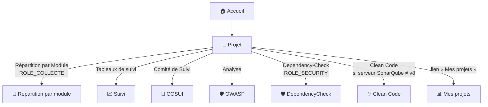
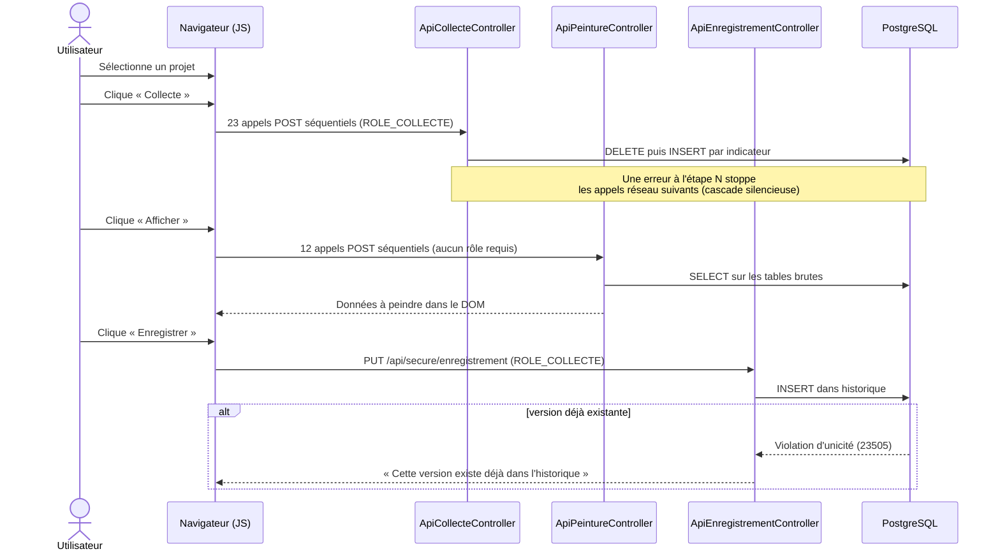
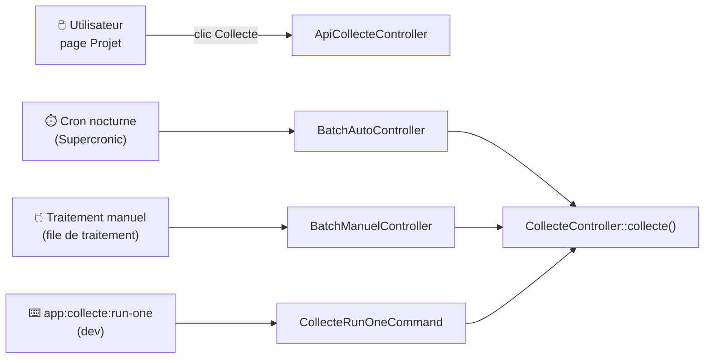
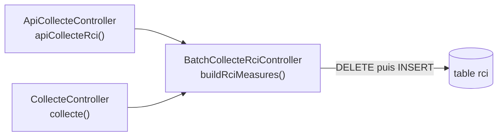

# 📁 Page Projet

La page Projet est **le cœur de l'application** : c'est ici qu'un projet SonarQube est sélectionné, collecté, visualisé, puis enregistré dans l'historique — et c'est le point de départ vers tous les autres tableaux de bord (OWASP, Clean Code, COSUI, Suivi, Répartition, DependencyCheck).

## 🗺️ Cartographie — pages accessibles depuis Projet

Le **bandeau commun** (logo, Préférences, Déconnexion, courriel) est identique sur toutes les pages — voir [Page d'accueil › Bandeau commun](accueil.md#bandeau-commun-present-sur-toutes-les-pages).

<!-- markdownlint-disable MD046 -->

<!-- markdownlint-enable MD046 -->

Deux façons de naviguer : un vrai lien `<a href>` (fil d'Ariane « Accueil », bouton « Dependency-Check ») ou un bouton piloté par JavaScript qui construit l'URL cible avec un jeton obfusqué (ROT13+Base64, pas une signature — confort de navigation, la vraie sécurité vient du pare-feu et des contrôles de rôle/périmètre serveur) et la clé du projet sélectionné (`Répartition`, `Suivi`, `COSUI`, `OWASP`, `Clean Code`) — dans les deux cas, un projet doit être sélectionné au préalable.

## 🧭 Chemin de fer de la page

L'écran se découpe en quatre zones, dans l'ordre où elles apparaissent :

<!-- markdownlint-disable MD046 -->
```text
Page Projet
│
├── 🧵 Fil d'Ariane : Accueil › Mon projet
├── 🔔 Zone de messages (messages JS uniquement, voir plus bas)
│
├── 📰 Zone Journal
│        └── Journal d'activité (log en lecture seule) + 🧹 bouton Effacer
│
├── 🔎 Zone Sélection du projet
│        ├── ⭐ Icône favori (bascule le projet sélectionné en favori)
│        ├── 🔽 Sélecteur de projet (filtré par groupe fonctionnel)
│        └── 📊 Bouton « Mes projets » → page dédiée (tableau complet)
│
├── ⚙️ Zone des actions
│        ├── 🔄 Collecte (ROLE_COLLECTE) — rafraîchit les données ou ajoute une 1ère analyse
│        ├── 👁️ Afficher — peinture depuis la base (aucun appel SonarQube)
│        ├── 💾 Enregistrer (ROLE_COLLECTE) — verse la version affichée dans l'historique
│        └── 🧭 Boutons de navigation → Répartition, Suivi, COSUI, OWASP, DependencyCheck, Clean Code
│
└── 📋 Zone principale — affichage des données
         ├── 🪧 Bandeau « Informations générales »
         └── 🧱 Triptyque : Version · Projet · Qualité
```
<!-- markdownlint-enable MD046 -->

## 📰 Zone Journal

Un journal d'activité (`<textarea readonly>`) affiche en direct la trace des appels effectués par la page (collecte, peinture, erreurs). Le bouton 🧹 (icône gomme) le vide sans rien envoyer au serveur — c'est un affichage purement local, rien n'est conservé après un rechargement de la page.

## 🔎 Zone Sélection du projet

Le sélecteur (Select2) recherche parmi les projets du **groupe fonctionnel** de l'utilisateur (voir [Groupes](../back-office/groupes.md#-groupe-fonctionnel)) — la recherche se déclenche à partir de **2 caractères** saisis (`minimumInputLength: 2`). Si l'utilisateur n'est rattaché à aucun groupe fonctionnel, ou qu'aucun tag SonarQube ne correspond à son périmètre, aucun projet n'est proposé.

L'icône ⭐ à côté du titre bascule le projet actuellement sélectionné en favori/non-favori (`POST /api/secure/favori`) — c'est la même liste de favoris que celle affichée sur la page [Accueil](accueil.md#-bloc-des-favoris) et gérée depuis [Préférences](preferences.md).

### 📊 Bouton « Mes projets »

Le bouton **Mes projets** ouvre directement la page dédiée `/projet/mes-projets` (route `mes_projets`) : un **tableau complet** (volumétrie, notes A-E, violations, composants, qualité du code, loggers, tests) pour tous les projets du **groupe fonctionnel** de l'utilisateur — pas seulement ses favoris.

Au-dessus du tableau, un badge 🎯 rappelle chaque groupe fonctionnel auquel l'utilisateur est rattaché (un utilisateur peut appartenir à plusieurs groupes) — utile pour situer immédiatement le périmètre du tableau affiché.

!!! note "✅ Modale supprimée, fonctionnalités unifiées"
    Le bouton ouvrait auparavant une **modale** limitée aux projets favoris, avec des raccourcis d'action (bulles **V / R / S / C / O / RM**) déjà simplifiés une première fois (raccourcis retirés) le même jour.
    Cette modale faisait doublon avec la page `/projet/mes-projets` (jusque-là accessible uniquement depuis le plan du site) : les deux portaient le même nom pour des listes différentes (favoris vs groupe fonctionnel entier).
    La modale, son JS (`afficheMesProjets()`, gestionnaires de clic) et son template (`_modal_liste_projet.html.twig`) ainsi que l'endpoint `projet_mes_applications_liste` ont été **supprimés** ; le bouton pointe désormais directement vers la page dédiée, plus riche.

!!! note "✅ Tableau DataTables (extension Zurb Foundation)"
    Un bug bloquant (clé `nom_projet` obsolète depuis un renommage de colonne DDL — devenue `project_name` — jamais répercuté dans ce template) empêchait l'affichage dès qu'un projet était présent dans l'historique.
    Corrigé, et le tableau est passé sous **DataTables** (extension `datatables.net-zf`, déjà utilisée sur [Statistiques › Projets](statistiques.md)) : recherche globale, tri par colonne (avec type numérique correct sur les colonnes de comptage), pagination à **15 lignes par défaut** (5/10/15/20/25 au choix).
    Le header à deux niveaux (groupes de colonnes + sous-colonnes) est géré nativement — plus de perte de l'en-tête en scrollant une longue liste.

!!! note "✅ Centrage des en-têtes de colonne (25/10/2026)"
    Les en-têtes restaient alignés à gauche malgré la classe `text-center` posée dans le template : la feuille de style du thème DataTables/Foundation (`table.dataTable thead th { text-align: left; }`) est plus spécifique que la classe utilitaire Foundation `.text-center` et l'emportait systématiquement — y compris sur la ligne d'en-tête groupée (colspan), que les réglages `columnDefs`/`className` de DataTables ne peuvent pas atteindre puisqu'ils ne s'appliquent qu'à la ligne « feuille » (une cellule par colonne réelle). Corrigé en ciblant l'ID de la table (`#table-mes-projets thead th.text-center` dans `mes-projets.css`), ce qui fonctionne sur les deux lignes d'en-tête sans dépendre des options JS de DataTables.

!!! note "✅ Encart d'information sur la colonne Version (23/10/2026)"
    Un encart rappelle désormais que la colonne **Version** correspond à la version analysée lors de la **dernière collecte** effectuée pour chaque projet — pas nécessairement à la dernière version publiée.

## ⚙️ Zone des actions

| Bouton | Visible si | Action |
| --- | --- | --- |
| **Collecte des données** | `ROLE_COLLECTE` | Lance la chaîne complète de collecte (20 appels SonarQube séquentiels — voir [flux ci-dessous](#-le-flux-collecte--peinture--sauvegarde)). Sert aussi bien à **rafraîchir** un projet déjà connu qu'à **collecter pour la première fois** un projet jamais analysé — c'est le même bouton et le même flux dans les deux cas. |
| **Afficher** | toujours | « Peinture » : relit les tables déjà en base pour la **dernière collecte connue** et remplit l'affichage — sans appeler SonarQube |
| **Enregistrer** | `ROLE_COLLECTE` | Verse la version actuellement affichée dans l'historique (`historique`), **si elle n'y existe pas déjà** — sinon message d'erreur (violation d'unicité) |
| **Mes projets** | toujours | Ouvre la page [Mes projets](#-bouton--mes-projets-) (tableau de tous les projets du groupe fonctionnel) |
| **Répartition par Module** | `ROLE_COLLECTE` | Ouvre [Répartition détaillée](repartition_details.md) |
| **Tableaux de suivi** | toujours | Ouvre [Suivi](suivi.md) |
| **Comité de Suivi (COSUI)** | toujours | Ouvre [COSUI](cosui.md) |
| **Analyse OWASP** | toujours | Ouvre [OWASP](owasp.md) (référentiels 2017/2021/2025) |
| **Dependency-Check** | `ROLE_SECURITY` | Ouvre [DependencyCheck](../dependency-check/pages.md) |
| **Clean Code** | serveur SonarQube ≠ version 8 (pas un rôle) | Ouvre [Clean Code](clean-code.md) |

Tous les boutons de navigation (sauf « Afficher » et « Mes projets ») sont **désactivés à l'affichage** et ne se débloquent qu'une fois un projet sélectionné.

!!! note "✅ Incohérence JS/serveur corrigée"
    Le script de la page tolérait auparavant `ROLE_BATCH` ou `ROLE_GESTIONNAIRE` comme alternative à `ROLE_COLLECTE` pour débloquer les boutons Collecte/Enregistrer — alors que ni l'un ni l'autre n'hérite de `ROLE_COLLECTE` dans `role_hierarchy` (voir [Gestion de la sécurité](../developpement/securite.md#-rôles-et-hiérarchie)), que le bouton lui-même n'est pas rendu par Twig sans `ROLE_COLLECTE`, et que le serveur (`ApiCollecteController`/`ApiEnregistrementController`) exige `ROLE_COLLECTE` strictement. Le contrôle JS a été aligné sur le serveur : seul `ROLE_COLLECTE` débloque désormais ces deux boutons.

## 📋 Zone principale — affichage des données

Trois blocs (« triptyque ») plus un bandeau, tous initialement vides et remplis par la collecte ou l'affichage :

!!! note "✅ Nouvelle présentation en tuiles (optionnelle, 25/10/2026)"
    Les données ci-dessous restent les mêmes ; seule leur mise en page peut changer. Depuis [Mes préférences](preferences.md#-tableau-des-préférences-4-interrupteurs) (option « Presentation »), un utilisateur peut basculer de ce triptyque classique en 3 colonnes vers une présentation en tuiles (une tuile par domaine : Application, Volumétrie, Complexité, Qualité interne, Tests & Violations, Analyse, Empreinte, Qualité, Répartition, Dette). Les deux présentations lisent et écrivent exactement les mêmes éléments du DOM (mêmes identifiants), donc le flux Collecte → Peinture décrit plus bas fonctionne à l'identique quel que soit le choix. Présentation classique par défaut.

!!! note "✅ Tuiles enrichies avec des métriques déjà collectées (25/10/2026)"
    Plusieurs tuiles affichent désormais des métriques déjà collectées et persistées par SonarQube, mais jamais montrées jusqu'ici (ni en tuiles, ni en présentation classique) :

    - **Tests & Violations** : statut du cycle de vie des violations (ouvertes / confirmées / réouvertes), en plus des violations déjà triées (acceptées / faux positifs) — et, parmi les acceptées, celles à fort impact (blocker/high).
    - **Qualité interne** : détail de la couverture (lignes, branches, conditions non couvertes) et de la duplication (lignes, blocs, fichiers dupliqués), avec une barre de progression pour chacune des deux mesures globales (masquée tant qu'aucune donnée n'a été peinte à l'écran).
    - **Complexité** : en plus des ratios déjà affichés (pour 1000 lignes de code — **ce ne sont pas des pourcentages**), le nombre total de points de complexité cyclomatique et cognitive (nouvelle section « Points de complexité »).

    Ces ajouts sont disponibles dans les deux présentations.

!!! note "✅ Corrections de mise en page des tuiles (25/10/2026)"
    - Les tuiles utilisaient une largeur calée sur leur contenu (`large-auto`), ce qui donnait des tuiles de largeurs très inégales sur une même ligne — remplacées par des largeurs fixes par breakpoint, avec un espacement géré par `grid-margin-x` (compense proprement la gouttière à tous les breakpoints, y compris en mode empilé sur mobile).
    - Les icônes de section (emoji) étaient répétées sans distinction entre plusieurs tuiles d'un même bloc — remplacées par des icônes distinctes ; la tuile « Répartition » dupliquée (deux tuiles de même nom pour des données différentes) a été renommée en « Modules ».
    - La ligne « Dette technique » de la tuile Dette pouvait chevaucher la ligne suivante quand la durée affichée était longue, faute de place (elle partageait sa ligne avec le label et le bouton de détail) — scindée en deux lignes.
    - En largeur mobile, la marge fixe de 2rem de part et d'autre du contenu de la page laissait trop peu de place aux tuiles — réduite (0,2 à 0,5rem selon la largeur) sur ce breakpoint uniquement.

!!! note "✅ Débordement de la ligne Maintenabilité (tuile Répartition, 27/10/2026)"
    Sur la tuile « Répartition », la ligne « Maintenabilité » affichait deux compteurs (mauvaises pratiques réelles / total) côte à côte, non compressibles — ils débordaient de la tuile sur un projet comptant beaucoup de violations. Scindée en deux sous-lignes (« Réelles » / « Total »), même convention que le détail par langage d'Accessibilité (`.ligne-sous-detail`), sans changer la largeur des tuiles ni leur disposition sur la page.

### 🏀 Bandeau « Informations générales »

Identité SonarQube du projet : nom, clé d'analyse, clé Maven, distribution des langages détectés. Purement informatif.

!!! note "✅ Ajout 2026-07-23 : pastille Actuator"
    Une pastille ronde à côté du libellé « Actuator » (⚪ grise / 🟢 verte / 🔴 rouge, voir [module Actuator](actuator.md#️-affichage-sur-la-page-projet)) ouvre une fenêtre modale listant les clés/valeurs de la dernière collecte du point d'accès Actuator déclaré pour ce projet (aucune donnée si aucun point d'accès n'est déclaré).

### 🏀 Bloc « Version »

- Version analysée, date de version, nombre de versions Release / Snapshot / Autres (bouton vers la modale *Répartition des versions*) ;
- Nombre de `NoSonar`/`@SuppressWarnings` (bouton vers le détail) ;
- Nombre de tags `TODO` (bouton vers le détail par langage/fichier) ;
- Nombre de loggers Java, avec accès au détail par framework et à un graphique de répartition.

!!! note "✅ Répartition en pourcentage par niveau de logger"
    La modale de détail des loggers affiche désormais, pour chaque niveau (`info`/`warn`/`error`/`debug`), un pourcentage (`niveau ÷ total`) et une barre de proportion en CSS (`width: calc(var(--percent) * 1%)`), en plus du nombre brut.

### 🏀 Bloc « Projet » (volumétrie + qualité interne)

- Statut de la **Quality Gate** SonarQube (badge coloré), et juste à côté la note **RCI** (Risk Criticality Index) ;
- Volumétrie : nombre de lignes, lignes de code, commentaires, fichiers, classes, méthodes, déclarations ;
- 5 indicateurs notés A-E : complexité cyclomatique, complexité cognitive, couverture de tests, densité de duplication, densité de commentaires ;
- Tests unitaires : nombre total, erreurs, échecs, ignorés, taux de succès ;
- Violations acceptées / faux positifs (marquées comme telles après revue).

!!! note "✅ 2026-09-29 : note RCI et détail par module"
    Une note A-E **RCI** (Risk Criticality Index, plugin `sonar-rci` porté en PHP) s'affiche désormais à côté de la Quality Gate. Un bouton ouvre une fenêtre modale avec le détail : un tableau (RCI, taux de dette, note) pour le global **et** pour chaque module (frontend/backend/autre/inconnu), plus un graphique en barres empilées RCI/Dette par colonne.
    Le détail par module repose sur une classification par mots-clés (chemins de fichiers) — marge d'erreur à prendre en compte, en particulier sur des projets au référentiel de règles ou à l'arborescence atypiques (bandeau d'avertissement affiché dans la modale).

!!! note "✅ Aide branchée sur la complexité"
    Un bouton **ℹ️** (« Aide ») a été ajouté au titre du bloc « Projet », ouvrant `_modal_complexity.html.twig` : une page pédagogique qui explique la complexité cyclomatique et cognitive (concepts SonarQube), **et** la formule réellement utilisée par Ma-Moulinette pour la note A-E affichée (`ratio = ncloc ÷ complexité`, seuils `≤3→E … >18→A`).

!!! note "✅ Note de complexité inversée"
    Le ratio `ncloc ÷ complexité` était converti en note A-E à l'envers : un ratio **faible** (complexité dense sur peu de lignes — code a priori moins bon) obtenait **A** (verte, meilleure), et un ratio **élevé** (code plus simple) obtenait **E** (rouge, pire).
    Corrigé dans `BuildMapHistoryService::getComplexityRating()` : ratio faible → **E**, ratio élevé → **A**, cohérent avec la convention A=bon/vert utilisée partout ailleurs dans l'app.
    Un ratio `null` (complexité absente) renvoie désormais `'--'` au lieu de `'A'` par accident de coercition PHP.

### 🏀 Bloc « Qualité » (fiabilité, sécurité, maintenabilité)

- Notes A-E de fiabilité, sécurité et maintenabilité (indice SQALE) ;
- Nombre de hotspots (bouton vers le détail des menaces potentielles) ;
- Détail bugs / vulnérabilités / mauvaises pratiques (réels vs total) ;
- Répartition par sévérité selon le module applicatif (Présentation/Métier/Autre/Inconnu — voir [Architecture des applications Java](../architecture/architecture-java.md)) ;
- Montant et ratio de la dette technique (bouton vers le détail) ;
- Nombre de violations à corriger (bouton vers la répartition par sévérité).

Aucun seuil de couleur n'est codé en dur dans les templates : les badges de notes A-E et les couleurs conditionnelles sont posés dynamiquement en JavaScript après réception des données.

!!! note "📌 Qu'est-ce qu'une anomalie « active » ? (statuses / issueStatuses)"
    Les comptages bugs/vulnérabilités/mauvaises pratiques interrogent `/api/issues/search` avec un filtre de statut, pour ne compter que les anomalies **encore actives** (pas déjà traitées).<br> Ce filtre change de paramètre et de vocabulaire selon la version du serveur SonarQube — le paramètre `statuses` est marqué déprécié depuis la version 10.4, remplacé par `issueStatuses`.

**Règle retenue** :

| Modèle | Serveur | Paramètre | Valeurs incluses | Valeurs exclues (= plus une anomalie) |
| --- | --- | --- | --- | --- |
| Ancien | 8, 9, 10 | `statuses` | `OPEN, CONFIRMED, REOPENED` | `RESOLVED`, `CLOSED` |
| Nouveau | 2024, 2025, 2026… | `issueStatuses` | `OPEN, CONFIRMED, ACCEPTED` | `FALSE_POSITIVE`, `FIXED` |

`FALSE_POSITIVE` et `FIXED` ne sont pas des anomalies (faux positif écarté, ou déjà corrigé).
`ACCEPTED` (nouveau modèle) est **inclus** : d'après la documentation SonarQube, *« You can accept an issue to fix it later »* — le défaut est toujours réel et non corrigé, juste reporté. Ce n'est donc pas l'équivalent de l'ancienne résolution « won't fix » (classement définitif) : c'est un report, pas une clôture. Compter `ACCEPTED` comme une anomalie active est donc cohérent avec le reste de la logique (un défaut présent dans le code tant qu'il n'est pas corrigé).

!!! warning "⚠️ Changement de comportement assumé par rapport à l'ancien modèle"
    En interne, « Accept » reste représenté par `status=RESOLVED` + `resolution=WONTFIX` côté ancien modèle — avec l'**ancien** filtre (`statuses=OPEN,CONFIRMED,REOPENED`), faire « Accept » sur une anomalie la **retire** du compteur (comme un `RESOLVED` classique).<br>
    Avec la règle retenue ici (`issueStatuses` incluant `ACCEPTED`), faire « Accept » ne fait **plus baisser** le compteur d'anomalies actives. C'est un choix délibéré, cohérent avec la doc SonarQube (le défaut reste réel tant qu'il n'est pas corrigé), mais une équipe habituée à l'ancien comportement (le compteur baissait après un triage « Accept ») verra une différence perceptible après la migration.

**Vérifié en conditions réelles** (comparaison live des deux filtres, serveur SonarQube 26.9.0, projet `monAppliation`) : avant bascule, `statuses=OPEN,CONFIRME REOPENED` et `issueStatuses=OPEN,CONFIRMED` valaient tous les deux 595. Après avoir basculé une issue BUG/BLOCKER en « Accept » dans l'interface SonarQube : `statuses=OPEN,CONFIRMED,REOPENED` et `issueStatuses=OPEN,CONFIRMED` descendent tous les deux à 594 (perdent l'issue), tandis que `issueStatuses=OPEN,CONFIRMED ACCEPTED` reste à 595 (la récupère) — confirmant que la règle retenue reproduit exactement le total de l'ancien modèle **avant** triage, tout en gardant les issues `ACCEPTED` dans le décompte après triage, contrairement à l'ancien modèle.

### 🏀 Bloc « Accessibilité »

!!! note "✅ Nouveau bloc 27/10/2026 : Accessibilité (tag SonarQube `accessibility`)"
    Nombre d'anomalies accessibilité (OPEN) détectées par SonarQube via le tag `accessibility` (122 règles couvrant les langages CSS / Web (HTML) / JavaScript / TypeScript), avec une note A-E — même méthode SQALE que RCI et Empreinte Écologique (dette estimée ÷ (ncloc × 30 min), seuils 5/10/20/50 %) — globale **et** par langage (4 lignes de détail affichées directement sous la ligne globale, sans modale).

    Pas de facette WCAG officielle côté SonarQube (confirmé en direct : `/api/issues/search?facets=wcag` renvoie 400 et liste exhaustivement les facettes supportées — aucune dédiée à l'accessibilité). Le tag `wcag` existe mais ne couvre que 6 règles très récentes ; le tag `accessibility`, bien plus représentatif, a été retenu comme filtre. Pas de numéro de critère WCAG (1.4.3, 2.4.4…) exploitable via l'API : seulement un détail par règle/sévérité/langage.

    Contrairement à l'Empreinte Écologique (plugins tiers Creedengo, activable via `CREEDENGO_ENABLED`), les règles d'accessibilité sont intégrées aux plugins de langage standards de SonarQube — pas de feature-flag, toujours collecté.

!!! note "✅ Historique alimenté par les deux pipelines, y compris un enregistrement manuel"
   Accessibilité suit le pattern **RCI** : `peinture.js` pose la réponse complète de l'API sur le `dataset` de l'élément pivot, relue par `enregistrement.js` au clic « Enregistrer ». `historique.accessibility_*` est donc alimenté quel que soit le pipeline (interactif ou batch/cron).

!!! note "✅ Distinction « 0 mesuré » / « non calculable »"
    Quand un langage n'a aucune ligne de code dans le projet (absent de `ncloc_language_distribution`), le nombre d'anomalies et la note affichent un tiret grisé plutôt que `0` : `0` reste réservé au cas réellement mesuré (le langage existe, zéro anomalie trouvée). Dans ce cas, `BatchCollecteaccessibilityController` n'effectue même pas l'appel `/api/issues/search` pour ce langage (langage absent détecté avant l'appel).

    Disponible dans les deux présentations (classique 3 colonnes et tuiles).

## 🔄 Le flux Collecte → Peinture → Sauvegarde

Trois opérations bien distinctes, souvent confondues :

- 🧺 **Collecte** = appelle l'API SonarQube et **écrase** (DELETE puis INSERT) les tables « brutes » du projet (`information_projet`, `mesures`, `owasp`, `hotspots`, `anomalie`, `anomalie_details`, `hotspot_owasp`, `hotspot_details`, `no_sonar`, `todo`, `logger`, `logger_detail`, `clean_code`).
Ces tables ne contiennent **que la dernière collecte** — ce ne sont pas des tables d'historique.
- 🎨 **Peinture** = relit ces tables déjà en base (**aucun appel SonarQube**) et remplit l'affichage. Fonctionne pour **n'importe quelle collecte antérieure**, par n'importe quel utilisateur, à tout moment — pas seulement celle qui vient d'être lancée dans la session courante.
- 💾 **Sauvegarde (Enregistrement)** = copie ce qui est actuellement affiché dans la table **`historique`**, versionnée celle-là (une ligne par version de projet). C'est la seule étape qui alimente durablement [Suivi](suivi.md) et les graphiques de tendance.



### 🎬 Cas à connaître

- **Projet jamais collecté** : « Afficher » échoue en 404 (« vous devez lancer une collecte ») tant que la collecte n'a pas été faite au moins une fois.
- **Projet déjà collecté par le passé** : « Afficher » fonctionne **directement**, sans relancer de collecte — il relit simplement la dernière collecte connue, quelle que soit sa date ou son auteur.
- **Erreur en cours de collecte** : l'étape en échec affiche un message et arrête les appels réseau suivants ; les indicateurs déjà collectés avant l'erreur restent en base (pas d'annulation globale).
- **Collecte réussie mais pas d'enregistrement** : les tables brutes contiennent bien les nouvelles données (consultables via « Afficher ») mais rien n'est écrit dans `historique`. À la prochaine collecte de ce projet, ces données seront écrasées — cette version n'aura alors **jamais existé** dans l'historique versionné.

!!! bug "🔴 Bug corrigé le 26/10/2026 — Enregistrer sans avoir cliqué Afficher au préalable"
    Cas réel : Collecte, puis clic direct sur « Enregistrer » **sans** passer par « Afficher » entre les deux. `enregistrement.js` lit l'intégralité de ses valeurs dans des éléments du DOM posés par `peinture.js` — certains, comme `#js-menace-potentielle-to-review-high`, sont injectés dynamiquement par `peinture.js` (absents du gabarit Twig tant qu'elle n'a jamais tourné), contrairement à la plupart des autres qui existent dès le chargement de la page (juste vides avant Peinture). Résultat : `TypeError: Cannot read properties of null (reading 'dataset')` en pleine fonction, sans aucun message pour l'utilisateur.
    Corrigé par un garde-fou en tout début de fonction : `#js-key-analyse` (toujours présent dans le gabarit) n'a son `dataset.analyseKey` rempli que par `peinture.js`, et n'est jamais vide pour un vrai projet peint — un indicateur fiable pour détecter ce cas tôt. Message désormais affiché : « Aucune donnée à enregistrer : lance une Peinture avant d'enregistrer. »

!!! caution "⚠️ La « peinture » ne vérifie pas le périmètre du groupe fonctionnel"
    Contrairement au sélecteur de projet (filtré par groupe fonctionnel), les routes `ApiPeintureController` ne vérifient que l'**existence** d'une clé maven en base — pas son appartenance au périmètre de l'utilisateur connecté.
    En théorie, un utilisateur qui connaîtrait la clé Maven exacte d'un projet hors de son périmètre pourrait en afficher les données via une requête directe.

!!! note "✅ Erreurs SonarQube correctement relayées pendant la collecte"
    `BatchCollecteInformationProjetController::controlVersionProjet()` n'anticipait que 3 codes d'erreur (401/404/503) : tout autre code (ex. `403 Insufficient privileges`) tombait dans une branche générique qui **remplaçait le vrai code/message par un « 500 » opaque**.
    Corrigé : le 403 est désormais géré explicitement, et le fallback générique **relaie le vrai code/message** de SonarQube au lieu de le masquer.
    `ApiCollecteController` envoyait aussi un texte placeholder (« Pas de données disponible. ») à la place d'une trace technique absente, ce qui affichait à tort un bouton « détails techniques » vide côté JS — corrigé pour envoyer `null`.
    .
    Ce genre de 403 vient le plus souvent d'un `SONAR_TOKEN` du **mauvais type** (jeton d'analyse au lieu de jeton personnel) — voir [Jetons d'authentification SonarQube](../developpement/securite.md#-jetons-dauthentification-sonarqube).

## 🤖 Deux pipelines de collecte : interactif et batch/cron

Le schéma « Collecte → Peinture → Sauvegarde » ci-dessus ne décrit que le **pipeline interactif** (bouton « Collecte » de la page Projet, piloté par `ApiCollecteController`). Il existe un **second pipeline**, totalement séparé, pour la collecte automatique/manuelle en masse (cron nocturne, file de traitement) — les deux s'appuient sur les **mêmes classes métier** (`Batch*Controller`), mais via des orchestrateurs et des chemins de persistance différents.

### 🚦 Qui déclenche quoi



- **Pipeline interactif** : `ApiCollecteController` expose une méthode par indicateur (`apiCollecteRci()`, `apiCollecteOwasp()`, …), appelées une à une en séquence par `index-projet.js` — c'est la seule voie qui peut être suivie visuellement, indicateur par indicateur, dans le navigateur.
- **Pipeline batch/cron** : trois déclencheurs différents (cron, file de traitement, commande console de dev) convergent tous vers **une seule méthode**, `CollecteController::collecte()`, qui enchaîne elle-même tous les indicateurs dans un seul appel serveur.

### 🔗 Une seule logique métier, deux points d'entrée



`BatchCollecteRciController::buildRciMeasures()` calcule **et** persiste le RCI de façon autonome (elle ne dépend d'aucune autre collecte préalable) — c'est pour cela qu'elle peut être appelée indifféremment par l'un ou l'autre pipeline, avec un résultat identique.

### 🗄️ Où atterrit `historique` selon le pipeline

- **Interactif** : `CollecteController` n'intervient pas — les indicateurs sont écrits dans les tables brutes (dont `rci`) un par un. Pour la plupart des indicateurs (dont RCI), le clic **« Enregistrer »** ne relit rien côté serveur : `enregistrement.js` reprend les valeurs déjà chargées dans le DOM par la peinture et les envoie dans le payload à `ApiEnregistrementController`, qui se contente de les reporter dans `historique`. `clean_code` est l'exception : son contrôleur relit directement sa table en base à cet instant. Voir « Cas à connaître » plus haut : sans le clic Enregistrer, `historique` reste inchangé dans tous les cas.
- **Batch/cron** : `CollecteController::collecte()` écrit dans les tables brutes **et** dans `historique` au sein du même appel — pas d'étape « Enregistrer » séparée, la collecte automatique est toujours historisée.

## ⚠️ Messages remontés par la page

Cette page n'a **aucun flash serveur** au chargement (`ProjetController::index()` n'appelle jamais `addFlash`) — tous les retours viennent des appels AJAX déclenchés par les actions, via `showMessage()` de `messageHelper.js`.

### Messages JS (client, après une action)

| Sévérité | Déclencheur | Message |
| --- | --- | --- |
| *(relayé du serveur)* | Chacune des 20 étapes de collecte / 9 étapes de peinture peut échouer côté API | Le message renvoyé par le serveur est affiché tel quel (`t.type`, `t.message`) |
| `critical` | Exception JS inattendue à l'une des ~13 phases numérotées de la collecte | 🔴 Une erreur inattendue s'est produite lors de la phase *NN*. |
| `success` | Collecte terminée sans erreur | *{projet}* Le processus de collecte a été réalisé avec success pour le projet *{maven_key}* ! |
| `error` | `ROLE_COLLECTE` manquant pour lancer la collecte | ❌ Vous devez avoir au moins le rôle COLLECTE pour lancer la collecte des données. |
| `error` | `ROLE_COLLECTE` manquant pour enregistrer | ❌ Vous devez avoir au moins le rôle COLLECTE pour lancer la commande d'enregistrement (Erreur 403). |
| `primary` | Changement de projet en cours de collecte | 📌 Le processus de collecte a été interrompu ! 💡 Choisissez un autre projet. |
| `primary` | Changement de projet en cours d'affichage | 📌 Le processus d'affichage des données a été interrompu ! Choisissez un autre projet. |
| `primary` | Affichage (peinture) terminé | 📌 L'affichage des informations pour le projet est terminée. |
| `warning` | Une étape de peinture ne renvoie aucune donnée | ⚠️ Aucune donnée disponible. Relancez une collecte ou afficher les derniers résultats. |

### 🏀 Page « Mes projets » — ses propres flashs serveur

La page `/projet/mes-projets` a ses propres messages Flash, distincts de la page Projet :

| Sévérité | Déclencheur | Message |
| --- | --- | --- |
| `warning` | Utilisateur sans groupe fonctionnel | ⚠️ Tu dois être rattaché à un groupe fonctionnel (Erreur 404). |
| `warning` | Aucun projet trouvé pour le groupe fonctionnel | ⚠️ Je n'ai pas trouvé de projets pour ton groupe fonctionnel. Vérifie le nom du tag utilisé dans SonarQube (Erreur 406). |
| `error` | Échec de la lecture de l'historique | ⚠️ Tu dois être rattaché à un groupe fonctionnel (Erreur 404). *(message générique réutilisé, trace technique en `debug`)* |

## 📚 Pour aller plus loin

- [OWASP](owasp.md) — analyse des vulnérabilités.
- [Clean Code](clean-code.md) — indicateurs SonarQube 10+.
- [COSUI](cosui.md) — comité de suivi.
- [Suivi](suivi.md) — historique des versions, alimenté uniquement après enregistrement.
- [Répartition détaillée](repartition_details.md) — signalements par module applicatif.
- [DependencyCheck](../dependency-check/pages.md) — vulnérabilités des dépendances.
- [Gestion de la sécurité](../developpement/securite.md) — détail des rôles.

-**-- FIN --**-

[Retour au menu principal](/index.html)
