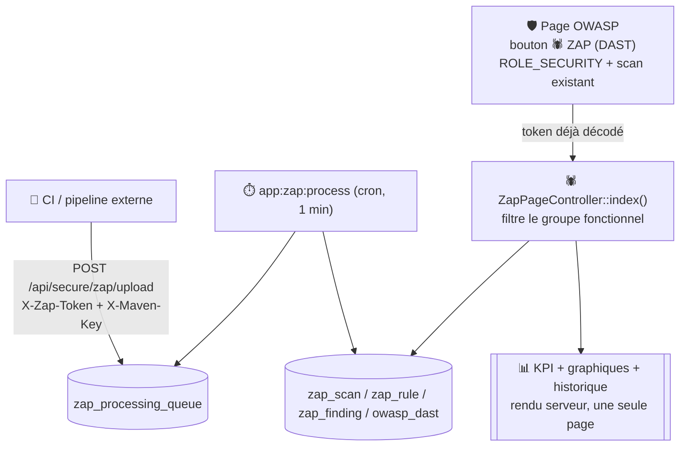

# 🕷️ Page ZAP (DAST)

Vue de restitution du scan **ZAP** (OWASP Zed Attack Proxy), un scanner **dynamique** (DAST — Dynamic Application Security Testing) : contrairement à [OWASP](owasp.md)/[Dependency-Check](../dependency-check/pages.md) qui analysent du code source ou des dépendances déclarées, ZAP envoie de vraies requêtes HTTP vers l'application en cours d'exécution et observe ses réponses. C'est une page de **lecture pure** : aucun scan n'est déclenché depuis l'interface, les rapports sont transmis par la CI.

!!! note "🔒 Rôle dédié, contrairement à OWASP"
    Toute la page (classe `ZapPageController`) est protégée par `ROLE_SECURITY` — le même rôle que [Dependency-Check](../dependency-check/pages.md), mais plus restrictif que la page [OWASP](owasp.md) elle-même (`ROLE_UTILISATEUR` suffit pour OWASP, seul son bouton Dependency-Check exige `ROLE_SECURITY`).

## 🔀 Ingestion : poussée par la CI, et non par l'application

Contrairement à SonarQube (collecte pilotée depuis la page [Projet](projet.md)), ZAP n'est jamais appelé par Ma-Moulinette : un rapport déjà généré ailleurs (pipeline CI) est **posté** vers l'application, qui se contente de l'ingérer puis de l'afficher — le même principe que Dependency-Check, pas celui des indicateurs SonarQube.

1. `POST /api/secure/zap/upload` (+ `X-Zap-Token`, `X-Maven-Key`, `X-Project-Version`) : dépose le rapport JSON (format `traditional-json`) en file d'attente (`zap_processing_queue`) — aucune identité de projet n'étant portée par le rapport ZAP lui-même (contrairement à Dependency-Check, qui embarque son propre `projectInfo`), les 2 derniers headers sont obligatoires.
2. `app:zap:process` (worker cron, toutes les minutes — voir [Commandes Prod](../commandes/prod.md)) dépile, décompresse, parse et ingère : scans (`zap_scan`), règles déclenchées (`zap_rule`, dédupliquées par `pluginid`), alertes (`zap_finding`), puis regroupement par catégorie OWASP 2017/2021 dans `owasp_dast` (même forme `a1..a10` que la table `owasp` du SAST, mais sur l'échelle de risque ZAP  `informational/low/medium/high` au lieu de l'échelle SonarQube `blocker/critical/major/minor/info`).
3. `GET /zap?token=...` affiche le dernier scan ingéré pour le projet.

## 🦊 Côté CI GitLab

L'identité du projet (`X-Maven-Key`, `X-Project-Version`) est **obligatoire** à l'upload — contrairement à Dependency-Check, qui la lit dans son propre rapport (`projectInfo`), ZAP ne contient aucune info projet dans son JSON.

C'est donc à la CI **du projet scanné** de la fournir, quel que soit son langage.

```bash
RESPONSE=$(curl -sS -w "\n%{http_code}" \
  -X POST \
  -H "Content-Type: application/json" \
  -H "X-Zap-Token: $ZAP_INGEST_TOKEN" \
  -H "X-Maven-Key: $MAVEN_KEY" \
  -H "X-Project-Version: $PROJECT_VERSION" \
  --data-binary "@zap-report.json" \
  "$MA_MOULINETTE_URL/api/secure/zap/upload")
HTTP_CODE=$(echo "$RESPONSE" | tail -n1)
# 202 = nouveau, 200 = idempotence (déjà reçu), autre = erreur
[ "$HTTP_CODE" -eq "202" ] || [ "$HTTP_CODE" -eq "200" ] || exit 1
```

Format accepté : `traditional-json` ZAP, brut (`application/json`) ou compressé (`application/gzip`/`application/x-gzip`) — explicitement **pas** `traditional-json-plus` (inclut les requêtes/réponses brutes, bien plus volumineux, hors périmètre). Polling optionnel du statut :

`GET /api/secure/zap/status/{ulid}` (même token), `ulid` renvoyé par l'upload.

### 🧬 D'où viennent `MAVEN_KEY` et `PROJECT_VERSION` selon le langage

!!! note "☕ Projet Maven (Java)"
    Mêmes `groupId`/`artifactId`/`version` que pour Dependency-Check, lus dans le `pom.xml` — voir[Exploitation Dependency-Check](../dependency-check/exploitation.md#-côté-ci-gitlab) pour le script d'extraction complet (le même `pom.xml` sert aux deux uploads).

!!! note "🟢 Node.js / 🐘 PHP (pas de Dependency-Check pour ces stacks)"
    Pas de `pom.xml` : la source la plus fiable est `sonar-project.properties`, qui doit déjà exister   pour l'analyse SonarQube elle-même (`sonar.projectKey=fr.ma-moulinette:miam`, par exemple).
    ```bash
    MAVEN_KEY=$(grep -E '^sonar\.projectKey=' sonar-project.properties | cut -d= -f2-)
    # Version : package.json (Node) ou composer.json (PHP, souvent absent pour une
    # appli — repli sur le tag/SHA du commit CI dans ce cas).
    PROJECT_VERSION=$(node -p "require('./package.json').version" 2>/dev/null \
      || jq -r '.version // empty' composer.json 2>/dev/null) \
      || PROJECT_VERSION="${CI_COMMIT_TAG:-${CI_COMMIT_SHORT_SHA:-unknown}}"
    ```
    Dependency-Check n'est **jamais** appelé pour ces deux stacks — seul ZAP s'applique, puisqu'il scanne    l'application en cours d'exécution, indépendamment du langage.

## 🗺️ Cartographie

<!-- markdownlint-disable MD046 -->

<!-- markdownlint-enable MD046 -->

## 🎯 Plusieurs cibles sous une même clé Maven (« lanes »)

Une clé Maven peut recouvrir **plusieurs cibles DAST réelles** — par exemple le tier présentation et le tier métier d'une même application, suivis sous la même clé côté SonarQube mais scannés séparément par ZAP (2 `target_url` distinctes). Depuis le 26/10/2026, la page affiche une **lane** (bloc KPI +
graphiques + tableaux + historique, entièrement indépendant) par `target_url` distincte détectée pour le projet (`ZapScanRepository::listDistinctTargetUrlsByMavenKey()`), plutôt que de mélanger leurs scans dans un seul historique — ce qui n'aurait aucun sens (comparer le volume d'alertes de deux applications différentes comme s'il s'agissait du même historique).

S'il n'existe qu'une seule cible pour le projet, une seule lane s'affiche et son titre « Cible : ... » reste masqué (pas de bruit visuel inutile pour le cas, très majoritaire, d'une seule cible). S'il en existe plusieurs, chacune s'affiche à la suite des autres, la plus récemment scannée en premier.

## 📋 Contenu de la page

- **Bandeau KPI** : date du dernier scan (+ version ZAP), cible scannée (URL), total d'alertes ;
- **Répartition par risque** : 4 badges HIGH/MEDIUM/LOW/INFORMATIONAL (classes CSS `badge-level` réutilisées de `dependency-check.css`, les 4 niveaux de risque ZAP se mappant directement sur les 4 niveaux déjà stylés pour Dependency-Check) ;
- **Graphique « Alertes par catégorie OWASP »** : un bar chart par référentiel présent (2017 et/ou 2021, selon les tags trouvés sur le dernier scan) ;
- **Tableau de synthèse par catégorie** : une ligne A1 à A10 par référentiel, nombre d'alertes (pas de détail par niveau de risque dans ce tableau — cette ventilation existe dans le graphique d'évolution) ;
- **Graphique « Évolution du risque »** : line chart, 4 séries (High/Medium/Low/Informational), un point par scan ingéré (pas un jour calendaire) ;
- **Tableau Historique** : les 20 scans les plus récents (pas de pagination), date/cible/total/badges par niveau de risque.

Chaque bloc de graphique/tableau est accompagné d'un encart pédagogique bleu (`info_callout`, même macro que `dependency_check/dashboard.html.twig`) expliquant comment le lire.

!!! caution "⚠️ Un score bas sur A07/A09/A10 ne veut pas dire « rien à signaler »"
    D'après la documentation officielle ZAP (vérifié sur `docs/scanners.md` et le guide *Zapping the OWASP Top 10 2021*) : très peu de règles automatisées ZAP sont taguées **A07** (authentification — surtout des outils manuels : comparaison de sessions, Forced Browse, génération de token) ; **A09** (journalisation/surveillance) n'a **aucune règle de détection** (ZAP peut générer du trafic qui *pourrait* déclencher des logs, mais ne vérifie jamais leur qualité réelle) ; **A10** (SSRF) dépend entièrement de l'add-on OAST, non activé par défaut.
    Un compteur à 0 sur ces catégories signifie « peu testé », pas « sans faille ». La page reprend cet avertissement dans son propre `info_callout`.

## 📅 Référentiels supportés

Seuls **2017 et 2021** sont construit (`OwaspDast::getCategoryCount()`/`ZapPageController::categoryLabels()`) — **2025 n'est pas proposé**, ZAP ne taguant pas encore ses règles sur ce référentiel (voir [Exploration OWASP API Security](../developpement/exploration-owasp-api-security.md)). Si une alerte ne porte aucun tag `OWASP_(2017|2021)_A0?(\d{1,2})` reconnu, elle n'apparaît dans aucune catégorie — un
callout dédié s'affiche alors à la place des graphiques/tableaux de catégorie (« Aucune des alertes de ce scan ne porte de tag OWASP 2017/2021 reconnu »).

## ⚠️ Messages remontés par la page

| Sévérité | Déclencheur | Message |
| --- | --- | --- |
| `info` | Paramètre `token` absent de l'URL | ℹ️ Sélectionnez un projet depuis la page Projet pour accéder à cette vue. |
| `error` | Décodage du token en échec (base64/format invalide) | ❌ La requête est incorrecte (Erreur 400). |
| `warning` | Projet hors périmètre du groupe fonctionnel (`ProjetPerimetreGuard`) | Message dynamique du garde-fou, préfixé `[ZAP]` |
| — (pas de flash) | Aucun scan ZAP ingéré pour ce projet | Callout « Aucun scan ZAP disponible pour ce projet. Les rapports ZAP sont posés par la CI sur `POST /api/secure/zap/upload`. » |

## 🔗 Point d'entrée unique

Pas de bouton dédié sur la page [Projet](projet.md) : la page ZAP se rejoint uniquement depuis le bouton 🕷️ **ZAP (DAST)** de la page [OWASP](owasp.md), qui transmet le token déjà décodé (pas de ré-encodage côté client) — voir [🔗 ZAP (DAST)](owasp.md#-zap-dast) sur cette page.

## 📄 Export PDF

`GET /zap/rapport/pdf?token=...` (bouton 📄 Export PDF sur la page) : synthèse par risque, catégories OWASP 2017/2021 (histogramme), évolution du risque (historique) et liste détaillée des alertes du dernier scan. Même mécanisme que `PdfExportService::generateOwaspPdf()` (Dompdf + Twig, `templates/rapport/rapport-zap.html.twig`), même jeton d'accès que la page web.

Paramètre `target_url` optionnel : précise la lane à exporter quand le projet en a plusieurs — chaque bouton Export PDF d'une lane le transmet automatiquement. Omis (lien historique ou externe), le PDF porte sur la cible la plus récemment scannée toutes cibles confondues.

!!! note "🧼 Description des règles : HTML externe assaini à l'ingestion"
    Les champs description/solution/référence de chaque règle proviennent du catalogue ZAP sous forme de HTML (`<p>...</p>`), assaini une seule fois à l'ingestion — voir [Sanitization du HTML externe](../developpement/securite.md#-sanitization-du-html-externe-rapports-zap).
    Dans ce PDF, l'aperçu tronqué de la description passe en plus par `striptags` : les balises `<p>` n'y seraient pas interprétées comme sur la page web, et resteraient visibles littéralement.

## 🚧 Hors périmètre (différé explicitement)

- **Vue transverse multi-projets** (pas de dashboard/comparer/mutualisables façon Dependency-Check) — la page reste volontairement centrée sur un seul projet.
- **Purge de la file ZAP** : commande `app:zap:purge` disponible (voir [Commandes Prod](../commandes/prod.md)) mais pas encore planifiée au cron.

## 📚 Pour aller plus loin

- [OWASP](owasp.md) — point d'entrée vers ZAP, et comparaison SAST/DAST.
- [Dependency-Check](../dependency-check/pages.md) — autre scanner de sécurité poussé par la CI, même principe d'ingestion.
- [Commandes Prod](../commandes/prod.md) — `app:zap:process` et `app:zap:purge`.
- [Exploration OWASP API Security](../developpement/exploration-owasp-api-security.md) — couverture réelle des règles ZAP par catégorie OWASP.
- [Gestion de la sécurité](../developpement/securite.md) — sanitization du HTML externe des règles ZAP, en-têtes de sécurité HTTP.

-**-- FIN --**-

[Retour au menu principal](/index.html)
