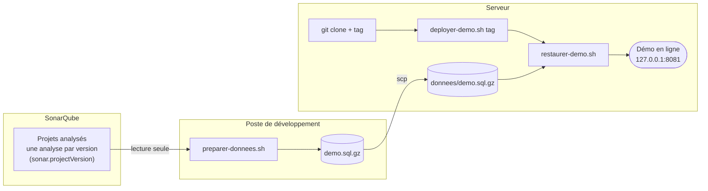

# 🎭 Instance de démonstration

Une instance **séparée** de Ma-Moulinette présente l'application avec les données de projets open source publics, sans jamais toucher à la production. Elle vit dans `docker/demo/` et ne partage avec la production ni base, ni réseau, ni volume, ni jeton.

!!! caution "⚠️ État d'avancement"
    La pile Docker, le mode démo applicatif et les scripts de déploiement sont livrés. Avant une ouverture publique, il reste la publication (nom de domaine, certificat, reverse proxy) : voir [Dépannage et reste à faire](demo/depannage.md#reste-a-faire-avant-ouverture). Tant que ce n'est pas fait, la pile n'écoute que sur `127.0.0.1` du serveur.

## 1️⃣ 🧭 L'essentiel en une minute

La démo se compose de **deux choses indépendantes**, qui évoluent à des rythmes différents :

| | Les **données** | Le **code** |
| --- | --- | --- |
| Ce que c'est | les projets, leurs versions, l'historique et les indicateurs affichés | l'application Ma-Moulinette, dans la version que vous choisissez (un *tag* git) |
| D'où cela vient | **SonarQube**, lu avec un compte en lecture seule | le dépôt git |
| Qui le fabrique | `preparer-donnees.sh`, sur le **poste de développement** | `deployer-demo.sh`, sur le **serveur** |
| Résultat | un fichier `demo.sql.gz` | un dossier `app`, monté dans les conteneurs |
| Change quand | vous voulez montrer d'autres projets ou d'autres versions de projets | vous publiez une nouvelle version de Ma-Moulinette |

Un troisième script, `restaurer-demo.sh`, **recharge les données dans la base** de la démo. Il est lancé automatiquement à la fin de `deployer-demo.sh`, puis chaque nuit par le planificateur du serveur.

<!-- markdownlint-disable MD046 -->

<!-- markdownlint-enable MD046 -->

## 2️⃣ 💡 Quatre idées à retenir

1. **La démo ne lit jamais votre instance de Ma-Moulinette.** Elle lit **SonarQube** directement. Il n'y a donc pas d'étape « mettre à jour Ma-Moulinette avec les versions à montrer » : ce qui compte, c'est que les versions voulues soient **analysées dans SonarQube**, chacune avec son `sonar.projectVersion`. La préparation les collecte dans une base jetable, sur le poste de développement.
2. **Les données sont fabriquées avant d'être déployées.** Le serveur ne collecte rien : pas de cron, pas de jeton de collecte. Il reçoit un fichier (`demo.sql.gz`) et le charge.
3. **Données et code doivent rester compatibles.** `demo.sql.gz` ne contient que des données, pas le schéma : ses colonnes doivent exister dans la base de la version déployée. Préparez les données avec le **même tag** que celui que vous déployez, ou un tag plus ancien, jamais un plus récent.
4. **Rien n'est transféré en dehors d'un fichier de données.** Le serveur clone le dépôt, construit le code et démarre les conteneurs, comme un pipeline de production. Aucune image n'est exportée.

## 3️⃣ 🚦 Quelle commande, quand ?

| Je veux… | Je fais… | Où | Page |
| --- | --- | --- | --- |
| **installer** la démo pour la première fois | préparer les données, cloner, `deployer-demo.sh <tag>`, planifier la restauration | poste puis serveur | [Installation initiale](demo/installation.md) |
| **publier une nouvelle version** de Ma-Moulinette | `deployer-demo.sh <nouveau-tag>` | serveur | [Mise à jour](demo/mise-a-jour.md#nouvelle-version-du-code) |
| **montrer d'autres projets** ou une nouvelle version d'un projet | analyser dans SonarQube, `preparer-donnees.sh`, copier le fichier, `restaurer-demo.sh` | poste puis serveur | [Mise à jour](demo/mise-a-jour.md#nouvelles-donnees) |
| **remettre la démo à zéro** (un visiteur a changé des réglages) | `restaurer-demo.sh` | serveur | [Mise à jour](demo/mise-a-jour.md#remise-a-zero) |
| **revenir** à la version précédente | restaurer l'archive de `app` et le tag précédent | serveur | [Mise à jour](demo/mise-a-jour.md#retour-arriere) |
| vérifier que le **compte SonarQube** de la démo est en lecture seule | `verifier-sonar.sh` | poste | [Préparer les données](demo/donnees.md#verifier-le-compte-sonarqube) |
| **comprendre** un script, ses options, ce qu'il modifie | — | — | [Référence des scripts](demo/scripts.md) |
| **diagnostiquer** une erreur | — | — | [Dépannage](demo/depannage.md) |

## 4️⃣ 🧱 Composition de la pile

| Conteneur | Rôle | Particularités |
| --- | --- | --- |
| `postgres-ma-moulinette-demo` | Base PostgreSQL 18 dédiée | Volume `ma-moulinette-demo-pgdata`, aucun port publié |
| `php-fpm-ma-moulinette-demo` | Application (`APP_ENV=prod`, `APP_DEBUG=0`, sans dépendances de développement) | Image PHP de la production, **sans code** : le dossier `app` (code construit, assets compilés) est monté en lecture seule ; aucun fichier `.env.local` |
| `nginx-ma-moulinette-demo` | Serveur HTTP | Publié sur `127.0.0.1:8081` uniquement ; HTTP interne, le TLS est porté par le reverse proxy de l'hôte |

**Aucun conteneur cron** : aucun traitement batch ne tourne dans la démo, et aucune purge de journaux n'est planifiée. Les données ne changent que par `restaurer-demo.sh`.

## 5️⃣ 📚 Plan de la documentation

| Page | Contenu |
| --- | --- |
| [Installation initiale](demo/installation.md) | prérequis, schéma du processus, commandes dans l'ordre |
| [Mise à jour](demo/mise-a-jour.md) | nouvelle version, nouvelles données, retour arrière, remise à zéro, renouvellement du jeton |
| [Préparer les données](demo/donnees.md) | ce qu'il faut dans SonarQube, `preparer-donnees.sh` et ses options, lecture du résultat |
| [Référence des scripts](demo/scripts.md) | chaque script : où, quand, pourquoi, options, ce qu'il modifie |
| [Étapes détaillées](demo/etapes-detaillees.md) | ce que fait `deployer-demo.sh`, étape par étape, pour comprendre ou dépanner |
| [Sécurité et mode démo](demo/securite.md) | isolation, secrets, compte de démonstration, liste blanche de routes |
| [Dépannage et reste à faire](demo/depannage.md) | pièges rencontrés, reste à faire avant ouverture |
