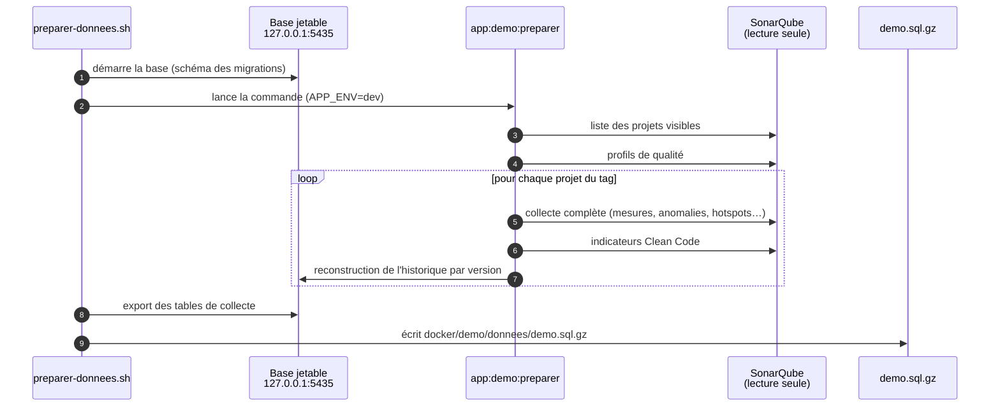

# 📥 Préparer les données

La démo n'interroge pas SonarQube pour chaque visiteur et ne collecte rien elle-même : elle affiche un **jeu de données préparé à l'avance**. Cette page explique comment le fabriquer, quand le refaire et comment lire le résultat.

!!! caution "Prérequis de la préparation"
    La préparation se fait **sur le poste de développement, jamais sur le serveur**. Avant de lancer `preparer-donnees.sh`, vérifiez :

    - **PHP et `vendor/`** : le script exécute `php bin/console` du dépôt local (faire `composer install` si `vendor/` manque) ;
    - **Docker démarré** et le port **`127.0.0.1:5435` libre** : il héberge la base jetable de préparation ;
    - **`docker/demo/.env`** renseigné, avec ces quatre variables non vides : `DEMO_SONAR_URL`, `DEMO_SONAR_TOKEN`, `DEMO_PREPA_POSTGRES_PASSWORD` et `DEMO_PREPA_DB_USER_PASSWORD` (types attendus dans `.env.exemple`) ;
    - **SonarQube joignable** depuis le poste, avec un jeton du compte `ma-moulinette-demo` **non expiré** (`verifier-sonar.sh` le contrôle) ;
    - **la bonne version du dépôt** : le schéma de la base jetable vient des migrations du dépôt local. Placez-vous sur le tag que vous allez déployer (ou un plus ancien), et ajoutez `--reinitialiser` si le schéma a changé depuis la dernière préparation ;
    - **les projets et leurs versions analysés dans SonarQube** (voir ci-dessous) : la préparation collecte ce qui existe, elle n'en crée pas.

## 1️⃣ 🧩 Ce qu'il faut côté SonarQube

| Besoin | Pourquoi |
| --- | --- |
| Les projets sont **analysés**, avec un `sonar.projectVersion` **différent à chaque version** | l'historique contient une ligne par version : sans plusieurs versions, les graphiques n'ont qu'un point. Une analyse sans `sonar.projectVersion` est enregistrée avec la valeur « not provided » |
| Les projets ont un **tag** qui commence par `ma-moulinette` | c'est le **groupe fonctionnel** du compte de démonstration : l'application ne propose que ces projets |
| Le compte `ma-moulinette-demo` a **Browse** sur ces projets, et **aucun droit global** | la préparation lit avec ce compte, en lecture seule. Il ne voit que les projets où il a Browse : les deux filtres (tag, droit) se cumulent |
| La version de SonarQube est **10 ou plus** | les indicateurs Clean Code n'existent pas avant. Sur un serveur plus ancien, cette étape est ignorée sans erreur (la page Clean Code est alors vide) |

### Vérifier le compte SonarQube

```bash
bash docker/demo/verifier-sonar.sh              # compte attendu : ma-moulinette-demo
bash docker/demo/verifier-sonar.sh autre-login  # un autre compte
```

Le script est **en lecture seule** : il ne tente aucune écriture et n'affiche jamais le jeton. Il contrôle que le compte n'a aucun droit global (administration, scan, création de projet), qu'il lit bien projets, mesures, anomalies, hotspots, analyses et profils, et qu'il est refusé sur le code source et les routes d'administration. **À lancer** à la création du compte, au renouvellement du jeton, et après toute modification des permissions dans SonarQube.

## 2️⃣ Ce que fait la préparation

<!-- markdownlint-disable MD046 -->

<!-- markdownlint-enable MD046 -->

Points importants :

- Tout se passe dans une **base jetable** (PostgreSQL sur `127.0.0.1:5435`), sans lien avec la production, le développement ou la démo. La commande **refuse de s'exécuter** pour toute autre connexion et hors `APP_ENV=dev` : elle vide et réécrit des tables.
- Les variables du `.env` (adresse et jeton SonarQube, mots de passe de la base jetable) sont imposées au processus : aucune base ni jeton de votre environnement habituel n'est utilisé.
- L'export contient les tables qui portent une clé de projet, plus `profiles` et `properties` (`TRUNCATE … CASCADE` puis `COPY`). Il ne contient **aucun compte** : le compte de démonstration est recréé à chaque restauration.
- L'export est **annulé** si la table `historique` est vide.
- La table `clean_code` n'est alimentée que par la collecte interactive de la page projet, pas par la collecte batch. La commande appelle donc cette collecte pour chaque projet ; sans elle, la page Clean Code de la démo resterait vide.

## 3️⃣ 🎛️ Options de `preparer-donnees.sh`

Sans option, le script collecte **tous** les projets du tag `ma-moulinette` et exporte. Les options servent à tester, à cibler ou à repartir de zéro.

| Option | Quand l'utiliser | Effet |
| --- | --- | --- |
| *(aucune)* | cas courant : premier passage, ou ajout de nouvelles versions | collecte ce qui est nouveau, puis exporte. Un projet déjà à jour est marqué « À JOUR » |
| `--reinitialiser` | vous **retirez** un projet, le **schéma** a changé, ou un passage précédent a échoué | détruit la base jetable (volume compris) puis recollecte tout |
| `--projet <clé>` | tester sur un projet, ou en ajouter un seul (option répétable) | ne collecte que ce(s) projet(s) |
| `--tag <préfixe>` | le groupe fonctionnel n'est pas `ma-moulinette` | change le préfixe de tag SonarQube |
| `--liste-seulement` | vérifier **quels projets** seraient retenus | affiche la liste, ne collecte ni n'exporte |
| `--sans-historique` | test rapide, ou dépannage | ne reconstruit pas l'historique par version (l'export sera refusé si l'historique est vide) |
| `--sans-export` | inspecter la base avant d'écrire `demo.sql.gz` | collecte sans exporter |
| `--export-seulement` | l'export a échoué, ou vous avez corrigé la base à la main | réexporte la base telle quelle, sans recollecter |

Exemples :

```bash
bash docker/demo/preparer-donnees.sh --liste-seulement                       # que va-t-on prendre ?
bash docker/demo/preparer-donnees.sh --projet fr.exemple:mon-projet           # un seul projet
bash docker/demo/preparer-donnees.sh --reinitialiser                          # tout recommencer proprement
```

## 4️⃣ 📖 Lire le résultat

Pendant la collecte, un tableau résume chaque projet :

| Colonne | Valeurs | Signification |
| --- | --- | --- |
| Collecte | `OK` | collecté |
| | `À JOUR` | l'analyse locale est déjà celle de SonarQube : la collecte s'arrête volontairement (code 202), ce n'est **pas** un échec |
| | `ÉCHEC` | à examiner (message sous le tableau) |
| Clean Code | `OK` | indicateurs collectés |
| | `NON SUPPORTÉ` | SonarQube antérieur à la version 10 : ignoré, pas une erreur |
| | `ÉCHEC` | à examiner |
| | `-` | non tenté, parce que la collecte a échoué |
| Historique | `OK` / `ÉCHEC` / `-` | reconstruction de l'historique par version |

À la fin, un second tableau donne `lignes_historique` et `lignes_clean_code` **par projet**. Contrôlez-le : un projet à `0` en Clean Code, ou à `1` en historique, aura une page vide ou un graphique d'un seul point. Si une étape échoue, la commande se termine en erreur et le script n'exporte pas.

## 5️⃣ 📤 Envoyer les données au serveur

Le fichier `docker/demo/donnees/demo.sql.gz` est ignoré par git : c'est un artefact de l'instance, pas du code. Il se copie à la main :

```bash
scp docker/demo/donnees/demo.sql.gz <utilisateur>@<serveur>:/opt/DOCKER/ma-moulinette-demo/depot/docker/demo/donnees/
```

Il est ensuite chargé par `restaurer-demo.sh` (seul, ou à la fin de `deployer-demo.sh`) : voir [Mise à jour](mise-a-jour.md#nouvelles-donnees).
