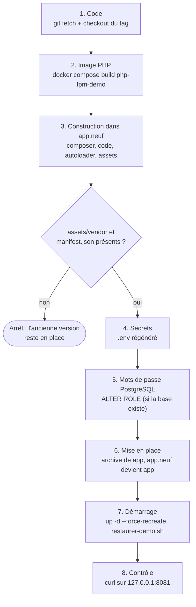

# 🔬 Étapes détaillées de `deployer-demo.sh`

En fonctionnement normal, **`deployer-demo.sh <tag>` suffit** : lisez plutôt [Installation initiale](installation.md) et [Mise à jour](mise-a-jour.md). Cette page détaille ce que le script fait, pour **comprendre**, **dépanner** ou **refaire une étape à la main**.

## 1️⃣ 🧭 Le principe

Même schéma que le pipeline de production : **construire le code, le placer dans un dossier, démarrer les conteneurs, rejouer le SQL**. Les conteneurs ne contiennent pas le code : ils le lisent dans le dossier `app`, monté en lecture seule (image PHP identique à celle de la production, image `nginx` officielle). Tout se fait sur le serveur, à partir d'un clone du dépôt, sans Composer ni PHP installés (Composer tourne dans un conteneur jetable).

| Étape du pipeline | Pour la démo |
| --- | --- |
| clonage, `composer install --no-dev`, `asset-map:compile` (job de construction) | étapes 1 à 3 |
| secrets d'environnement | étape 4 |
| décompression de l'artefact, sauvegarde `tar.gz` de l'ancienne version | étape 6 |
| redémarrage des conteneurs, scripts SQL | étape 7 |



## 2️⃣ 🗂️ Organisation sur le serveur

`SRV` est le dossier de travail (par défaut `/opt/DOCKER/ma-moulinette-demo`) :

```plaintext
$SRV/depot/         clone du dépôt (git fetch / checkout à chaque version)
$SRV/app/           code construit, monté dans les conteneurs
$SRV/app.neuf/      construction en cours (devient app)
$SRV/sauvegardes/   archives tar.gz de app, copies de .env
```

Le fichier `depot/docker/demo/.env` et le dossier `depot/docker/demo/donnees/` sont ignorés par git : ils restent sur le serveur d'une version à l'autre.

## 3️⃣ 🛠️ Les étapes à la main

```bash
# 1. Clone et version à déployer
export SRV=/opt/DOCKER/ma-moulinette-demo
mkdir -p $SRV/sauvegardes && cd $SRV
git clone https://github.com/Laurent-hadjadj/ma-moulinette.git depot
cd depot && git checkout <tag>                      # ex. v2.9.0

# 2. Image PHP (la même que la production, sans code)
cd $SRV/depot/docker/demo
docker compose -f docker-compose.demo.yml build php-fpm-demo
#    (le compose exige les secrets même pour construire : renseigner .env avant, ou préfixer la commande par
#     DEMO_POSTGRES_PASSWORD=x DEMO_DB_USER_PASSWORD=x DEMO_APP_SECRET=x)

# 3. Construire le code dans app.neuf : uniquement ce qui sert à l'exécution
#    a) dépendances de production. Composer tourne dans un dossier qui ne contient que composer.json :
#       sans symfony.lock (non versionné), Symfony Flex y dépose des fichiers d'exemple (compose.yaml, base.html.twig...)
#       qui n'ont rien à faire dans la démo ; on ne garde donc que vendor/.
cd $SRV/depot
rm -rf $SRV/app.neuf && mkdir $SRV/app.neuf
cp composer.json $SRV/app.neuf/
docker run --rm -v $SRV/app.neuf:/app -w /app composer:lts \
  composer install --no-dev --no-interaction --no-scripts --no-progress --prefer-dist --ignore-platform-reqs
find $SRV/app.neuf -mindepth 1 -maxdepth 1 ! -name vendor ! -name composer.json ! -name composer.lock -exec rm -rf {} +

#    b) code de l'application (rien d'autre : ni tests, ni documentation, ni .git)
cp -r bin config public src templates translations assets migrations importmap.php .env $SRV/app.neuf/
cp assets/js/common/secrets.local.js.dist $SRV/app.neuf/assets/js/common/secrets.local.js

#    c) autoloader optimisé (sans --classmap-authoritative : sur certains montages il omet des classes)
docker run --rm -v $SRV/app.neuf:/app -w /app composer:lts \
  composer dump-autoload --optimize --no-dev --ignore-platform-reqs

#    d) assets JavaScript puis compilation. assets/vendor/ (foundation-sites, jquery, chart.js...) est ignoré par git :
#       importmap:install le télécharge depuis le CDN des paquets (le serveur doit joindre Internet).
#       Toute variable citée par config/ reçoit une valeur factice, pour ces commandes seulement.
ENVS=$(grep -rhoE '%env\((\w+:)*[A-Z0-9_]+\)%' config | sed -E 's/.*[(:]([A-Z0-9_]+)\)%/\1/' | sort -u | sed 's/.*/-e &=construction/' | tr '\n' ' ')
docker run --rm $ENVS -e APP_ENV=prod -e APP_DEBUG=0 -e TRUSTED_PROXIES=127.0.0.1 \
  -e 'DATABASE_URL=postgresql://x:x@localhost/x?serverVersion=18' \
  -v $SRV/app.neuf:/var/www -w /var/www ma-moulinette-php-demo:8.5.12 \
  sh -c 'php bin/console importmap:install --no-interaction && php bin/console asset-map:compile --no-interaction'
ls $SRV/app.neuf/assets/vendor | head -3            # foundation-sites, jquery... doivent exister
ls $SRV/app.neuf/public/assets/manifest.json        # doit exister

# 4. Secrets : voir « Sécurité et mode démo » pour les types (DEMO_APP_SECRET en base64, mots de passe PostgreSQL en hexadécimal)
cd $SRV/depot/docker/demo
cp .env.exemple .env && nano .env && chmod 600 .env
mkdir -p donnees                                    # puis copier demo.sql.gz depuis le poste (scp)

# 6. Mettre en place (sauvegarde de l'ancienne version s'il y en a une)
docker compose -f docker-compose.demo.yml stop nginx-demo php-fpm-demo
[ -d $SRV/app ] && tar -czf $SRV/sauvegardes/app-$(date +%Y%m%d-%H%M).tar.gz -C $SRV app
rm -rf $SRV/app && mv $SRV/app.neuf $SRV/app

# 7. Démarrer puis rejouer le SQL : schéma, jeu de données, compte de démonstration
docker compose -f docker-compose.demo.yml up -d --force-recreate
bash restaurer-demo.sh

# 8. Contrôle (nginx n'écoute que sur 127.0.0.1 : le reverse proxy publie)
curl -I http://127.0.0.1:8081/
```

(L'étape 5 du script, `ALTER ROLE`, n'existe pas à la main lors d'une première installation : le rôle est créé avec le mot de passe du `.env`.)

## 4️⃣ ❓ Pourquoi ces choix

| Choix | Raison |
| --- | --- |
| Composer dans un dossier qui ne contient que `composer.json` | sans `symfony.lock` (non versionné), Symfony Flex ajoute des fichiers d'exemple au dossier du code |
| `composer dump-autoload` **sans** `--classmap-authoritative` | sur certains montages, l'autoloader « authoritative » omettait des classes (`CompilerPassInterface not found`) |
| `importmap:install` avant `asset-map:compile` | `assets/vendor/` est ignoré par git ; sans lui, la compilation échoue (« vendor asset is missing ») |
| Variables factices pour la compilation | le conteneur de construction n'a pas les variables d'exécution ; toute variable citée par `config/` reçoit une valeur factice, uniquement pour cette commande |
| `assets/js/common/secrets.local.js` repris du modèle `.dist` | le fichier réel est ignoré par git (fourni par le pipeline) ; le modèle contient `token = null` |
| Mots de passe PostgreSQL appliqués par `ALTER ROLE` | PostgreSQL ne relit pas `POSTGRES_PASSWORD` une fois son volume créé |
| Cache Symfony purgé au démarrage du conteneur | le cache `prod` n'est jamais recalculé tout seul : sans purge, l'ancien code est servi |

## 5️⃣ 🔁 Repartir de zéro

```bash
cd $SRV/depot/docker/demo
docker compose -f docker-compose.demo.yml down -v      # supprime aussi les volumes de la démo (base comprise)
```

Puis reprendre à l'étape 7 (le code construit est conservé dans `app/`). `restaurer-demo.sh` ne recrée pas les volumes : le rôle et la base sont créés par `init-schema.sh` au premier démarrage d'un volume vide.
