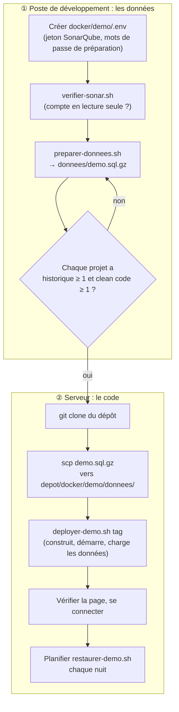

# 🚀 Installation initiale

Cette page décrit la **première mise en service** de la démo. Elle se fait en deux temps : d'abord les **données** (sur le poste de développement), ensuite le **code** (sur le serveur). Pour les installations suivantes, voir [Mise à jour](mise-a-jour.md).

## 1️⃣ ✅ Avant de commencer

| Prérequis | Où | Pourquoi | Comment vérifier |
| --- | --- | --- | --- |
| Les projets à montrer sont **analysés dans SonarQube**, avec **plusieurs versions** (`sonar.projectVersion` distinct) | SonarQube | l'historique n'a qu'une ligne par version : une seule analyse donne une courbe d'un point | page du projet dans SonarQube, onglet *Activity* |
| Ces projets portent un **tag SonarQube** qui commence par `ma-moulinette` | SonarQube | c'est le groupe fonctionnel du compte de démonstration : seuls ces projets sont proposés | page du projet, tags |
| Un **compte SonarQube de lecture seule** (`ma-moulinette-demo`) avec *Browse* sur ces projets, et son **jeton** | SonarQube | la préparation lit SonarQube avec ce compte, jamais avec un compte privilégié | `bash docker/demo/verifier-sonar.sh` |
| Le poste de développement a PHP, `vendor/` et Docker | poste | `preparer-donnees.sh` lance `php bin/console` et une base PostgreSQL jetable | `php -v`, `docker version` |
| Le serveur a Docker (avec Compose), `git`, `openssl`, `curl` et un accès à Internet | serveur | la construction télécharge Composer, les paquets PHP et JavaScript | `docker compose version`, `git --version` |

## 2️⃣ 🗺️ Le processus

<!-- markdownlint-disable MD046 -->

<!-- markdownlint-enable MD046 -->

## 3️⃣ ① Sur le poste de développement : préparer les données

**Pourquoi d'abord ?** Le déploiement se termine par le chargement des données : le fichier doit donc exister sur le serveur avant de lancer `deployer-demo.sh`.

```bash
# 1. Créer le fichier d'environnement du poste et le renseigner
cp docker/demo/.env.exemple docker/demo/.env
#    à remplir : DEMO_SONAR_URL, DEMO_SONAR_TOKEN, DEMO_PREPA_POSTGRES_PASSWORD, DEMO_PREPA_DB_USER_PASSWORD
#    (les types attendus sont dans docker/demo/.env.exemple : openssl rand -hex 24 pour les mots de passe)

# 2. Contrôler le compte SonarQube (lecture seule, aucune écriture)
bash docker/demo/verifier-sonar.sh

# 3. Collecter dans une base jetable et exporter
bash docker/demo/preparer-donnees.sh
```

À la fin, le script affiche un tableau. **Contrôlez-le** avant d'aller plus loin :

```text
 maven_key                       | lignes_historique | lignes_clean_code
---------------------------------+-------------------+------------------
 fr.exemple:mon-projet           |                 4 |                 1
```

- `lignes_historique` = nombre de versions analysées (une ligne par `sonar.projectVersion`). Une valeur à 1 donne un graphique d'un seul point.
- `lignes_clean_code` à 0 : la page Clean Code de ce projet sera vide (voir [Préparer les données](donnees.md#lire-le-resultat)).

Le résultat est `docker/demo/donnees/demo.sql.gz`. Ce dossier est ignoré par git : le fichier n'est jamais commité.

## 4️⃣ ② Sur le serveur : déployer le code

```bash
# 1. Cloner le dépôt une seule fois (remplacer le dossier si besoin)
git clone https://github.com/Laurent-hadjadj/ma-moulinette.git /opt/DOCKER/ma-moulinette-demo/depot
mkdir -p /opt/DOCKER/ma-moulinette-demo/depot/docker/demo/donnees

# 2. Copier le jeu de données (commande à lancer depuis le POSTE, pas depuis le serveur)
scp docker/demo/donnees/demo.sql.gz <utilisateur>@<serveur>:/opt/DOCKER/ma-moulinette-demo/depot/docker/demo/donnees/

# 3. Déployer la version choisie (le tag doit exister dans le dépôt)
bash /opt/DOCKER/ma-moulinette-demo/depot/docker/demo/deployer-demo.sh v2.9.0
```

!!! caution "Tag minimal : `v2.9.0`"
    `deployer-demo.sh` et le compose « code monté » n'existent qu'à partir de **`v2.9.0`**. Le tag `v2.8.0` contient l'ancienne pile (code intégré aux images) : ne le déployez pas avec ce script. Le tag doit aussi être posé **après** le commit de ces fichiers, et poussé.

`deployer-demo.sh` fait **tout le reste** : il construit le code, génère les secrets, démarre les conteneurs, charge les données et contrôle que la page répond. Le détail de chaque étape est dans [Étapes détaillées](etapes-detaillees.md).

!!! info "Au premier déploiement"
    - Le script **affiche une seule fois** le mot de passe du compte `demo@ma-moulinette.fr`. Notez-le : il est ensuite conservé dans `docker/demo/.env` du serveur, mais il est communiqué aux visiteurs.
    - Pour que la démo puisse interroger SonarQube en direct, donnez l'adresse et le jeton à ce premier lancement : `DEMO_SONAR_URL=https://… DEMO_SONAR_TOKEN=… bash …/deployer-demo.sh v2.9.0`. Sans eux, la démo n'émet aucun appel sortant.
    - Les secrets (mots de passe de la base, clé applicative) sont **générés** par le script : vous n'avez rien à saisir. Ils sont régénérés à chaque déploiement.

## 5️⃣ 🔎 Vérifier

La démo n'écoute que sur `127.0.0.1` du serveur. Pour l'ouvrir depuis votre navigateur, utilisez un tunnel SSH, **depuis votre poste** :

```bash
ssh -L 8082:127.0.0.1:8081 <utilisateur>@<serveur>      # laisser la fenêtre ouverte
```

Puis ouvrez `http://localhost:8082/` (et non l'adresse IP du serveur : l'application n'accepte que `localhost` et `127.0.0.1`, et son cookie de session est « sécurisé », accepté en HTTP uniquement sur `localhost`). Connectez-vous avec `demo@ma-moulinette.fr` et le mot de passe affiché au déploiement.

Contrôles rapides sur le serveur :

```bash
curl -I http://127.0.0.1:8081/                                          # 200 ou 302
docker compose -f /opt/DOCKER/ma-moulinette-demo/depot/docker/demo/docker-compose.demo.yml ps   # 3 conteneurs « running »
```

## 6️⃣ 🌙 Planifier la restauration nocturne

La démo n'embarque aucun cron. Pour que les modifications des visiteurs (avatar, préférences, version de référence) disparaissent chaque nuit, planifiez `restaurer-demo.sh` **sur l'hôte** avec le planificateur du serveur :

```bash
# exemple de ligne de crontab (crontab -e en root) : tous les jours à 03h30
30 3 * * * bash /opt/DOCKER/ma-moulinette-demo/depot/docker/demo/restaurer-demo.sh >> /var/log/ma-moulinette-demo-restauration.log 2>&1
```

Le script arrête l'application, recrée la base, rejoue le schéma, recharge `demo.sql.gz`, recrée le compte de démonstration, puis redémarre l'application. La démo est indisponible pendant la restauration : choisissez une heure creuse.

## 7️⃣ ➡️ Et ensuite ?

- Publier la démo sous un nom de domaine : [Reste à faire avant ouverture](depannage.md#reste-a-faire-avant-ouverture).
- Une nouvelle version, d'autres projets : [Mise à jour](mise-a-jour.md).
- Une erreur : [Dépannage](depannage.md).
