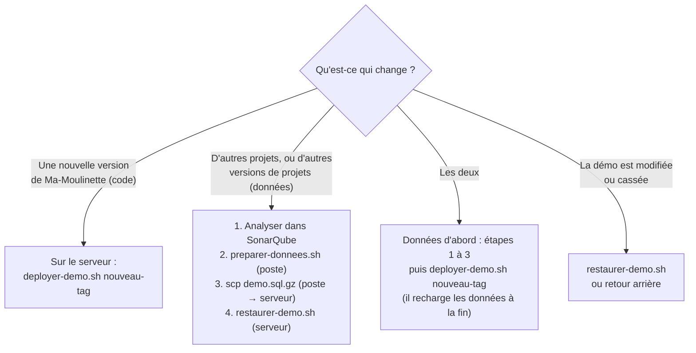

# 🔄 Mise à jour

Une fois la démo installée ([Installation initiale](installation.md)), trois situations reviennent. Commencez par identifier **ce qui change**.



Règle de cohérence : les données sont un export **sans schéma**. Préparez-les avec le **même tag** que celui que vous déployez, ou un tag plus ancien, jamais un plus récent. Si la nouvelle version change le schéma (nouvelle migration), préparez les données depuis ce tag avec `--reinitialiser` (voir [Préparer les données](donnees.md#options-de-preparer-donneessh)).

## 1️⃣ 🧱 Nouvelle version du code

**Quand ?** Vous avez publié une nouvelle version de Ma-Moulinette (un nouveau tag) et voulez la montrer.

**Prérequis :** le tag existe dans le dépôt et contient bien les commits voulus (poussez la branche *avant* de poser ou de déplacer le tag).

```bash
bash /opt/DOCKER/ma-moulinette-demo/depot/docker/demo/deployer-demo.sh v2.9.0
```

C'est la **même commande** que pour l'installation, avec le nouveau tag. Elle :

- récupère le tag, reconstruit le code dans un dossier à part (l'ancienne version reste en place tant que la construction n'est pas complète) ;
- régénère les secrets, **sauf** le mot de passe du compte de démonstration et les paramètres SonarQube, qui sont conservés ;
- range l'ancienne version dans une archive `sauvegardes/app-AAAAMMJJ-HHMM.tar.gz` ;
- redémarre les conteneurs, recharge les données (`restaurer-demo.sh`) et contrôle que la page répond.

Les visiteurs perdent leur session (les secrets changent) : sans conséquence pour une démo.

## 2️⃣ 📥 Nouvelles données

**Quand ?** Vous voulez montrer **un autre projet**, ou **une version de plus** d'un projet.

```bash
# 1. Dans SonarQube : analyser le projet avec le nouveau sonar.projectVersion (hors de cette documentation)

# 2. Sur le POSTE de développement : recollecter et réexporter
bash docker/demo/preparer-donnees.sh
#    ajoutez --reinitialiser pour repartir d'une base vide (voir plus bas quand le faire)

# 3. Toujours depuis le poste : envoyer le fichier au serveur
scp docker/demo/donnees/demo.sql.gz <utilisateur>@<serveur>:/opt/DOCKER/ma-moulinette-demo/depot/docker/demo/donnees/

# 4. Sur le SERVEUR : charger les nouvelles données (ni construction, ni redémarrage complet)
bash /opt/DOCKER/ma-moulinette-demo/depot/docker/demo/restaurer-demo.sh
```

**Quand ajouter `--reinitialiser` à l'étape 2 ?** La base de préparation conserve ses données d'un passage à l'autre : relancer le script ne collecte que ce qui est nouveau. Repartez d'une base vide si vous **retirez** un projet, si la nouvelle version du code **change le schéma**, ou si un passage précédent a échoué en laissant la base dans un état douteux.

## 3️⃣ 🔁 Les deux à la fois

Envoyez d'abord le fichier de données (étapes 1 à 3 ci-dessus), **puis** lancez `deployer-demo.sh nouveau-tag`. Comme le déploiement se termine par le chargement des données, la nouvelle version démarre directement avec le nouveau jeu : une seule interruption.

## 4️⃣ ↩️ Retour arrière

**Quand ?** La nouvelle version pose problème et vous voulez revenir à la précédente.

L'archive de l'ancien dossier `app` est dans `sauvegardes/`. Le schéma SQL dépend du tag : revenez aussi au tag précédent dans le clone.

```bash
SRV=/opt/DOCKER/ma-moulinette-demo
cd $SRV/depot && git checkout <ancien-tag>
cd docker/demo
docker compose -f docker-compose.demo.yml stop nginx-demo php-fpm-demo
rm -rf $SRV/app && tar -xzf $SRV/sauvegardes/app-<date>.tar.gz -C $SRV
docker compose -f docker-compose.demo.yml up -d --force-recreate
bash restaurer-demo.sh
```

Le fichier `.env` a été régénéré par le déploiement raté ; l'ancien est dans `sauvegardes/env-AAAAMMJJ-HHMM`. Les mots de passe de la base en vigueur sont ceux du `.env` actuel : ne le remplacez pas par l'ancien.

## 5️⃣ 🧹 Remise à zéro

**Quand ?** Un visiteur a modifié des réglages, ou vous voulez vérifier l'état de référence.

```bash
bash /opt/DOCKER/ma-moulinette-demo/depot/docker/demo/restaurer-demo.sh
```

C'est ce que fait la restauration nocturne. Pour repartir **de rien** (volumes compris : base PostgreSQL), utilisez en dernier recours :

```bash
cd /opt/DOCKER/ma-moulinette-demo/depot/docker/demo
docker compose -f docker-compose.demo.yml down -v
bash deployer-demo.sh <tag>
```

## 6️⃣ 🔑 Renouveler le jeton SonarQube

Le jeton du compte `ma-moulinette-demo` a une **durée limitée** (notez sa date d'expiration). `deployer-demo.sh` conserve la valeur du `.env` : pour la changer, modifiez-la à la main sur le serveur, puis recréez le conteneur PHP.

```bash
cd /opt/DOCKER/ma-moulinette-demo/depot/docker/demo
nano .env                                                                  # DEMO_SONAR_TOKEN=nouveau-jeton
docker compose -f docker-compose.demo.yml up -d --force-recreate php-fpm-demo
```

Sur le **poste de développement**, mettez aussi à jour `docker/demo/.env` : `preparer-donnees.sh` lit le même nom de variable.

## 7️⃣ 🧰 Autres opérations

- **Nettoyer les images devenues inutiles** après plusieurs mises à jour : `docker image prune`.
- **Les dépendances** (`composer.lock` n'est pas versionné, comme pour le pipeline) : chaque construction résout les versions autorisées par `composer.json`.
- **Reconstruire l'image PHP** (si `docker/php-custom.dockerfile` a changé dans le nouveau tag) : `deployer-demo.sh` le fait à chaque déploiement, grâce au cache Docker.
